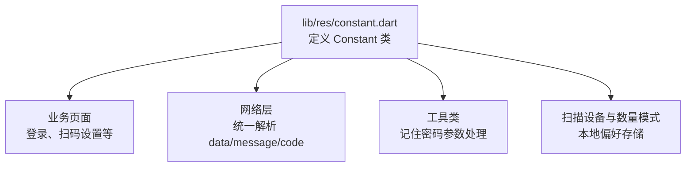
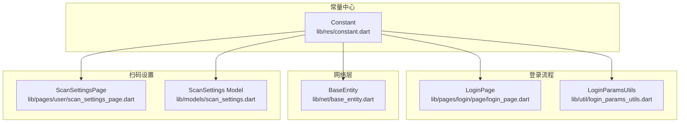
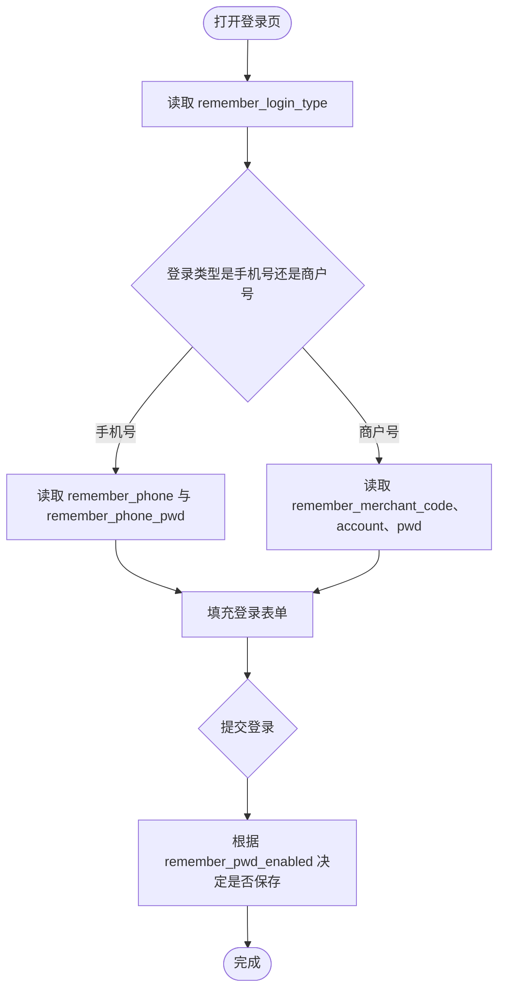
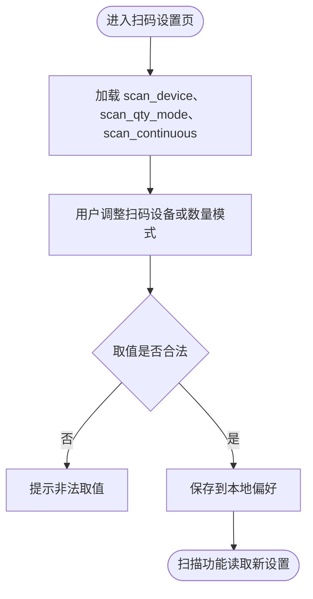
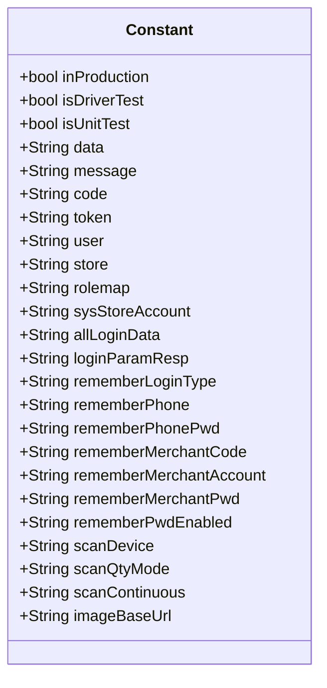
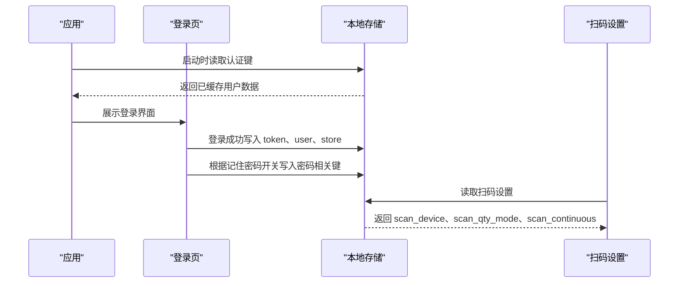
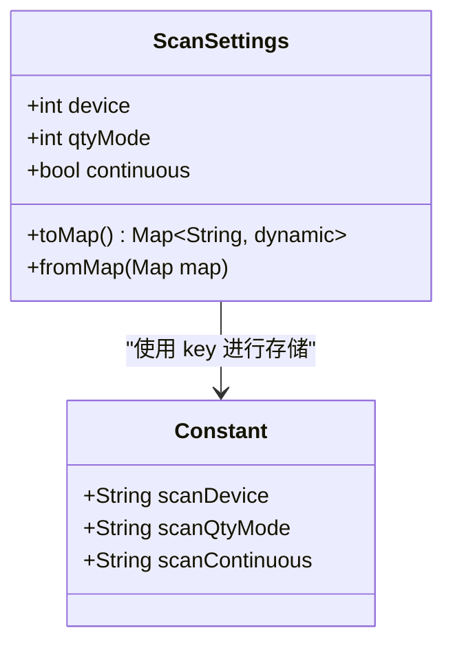

# 应用常量配置

<cite>
**本文引用的文件**   
- [lib/res/constant.dart](file://lib/res/constant.dart)
- [lib/net/base_entity.dart](file://lib/net/base_entity.dart)
- [lib/pages/login/page/login_page.dart](file://lib/pages/login/page/login_page.dart)
- [lib/util/login_params_utils.dart](file://lib/util/login_params_utils.dart)
- [lib/pages/user/scan_settings_page.dart](file://lib/pages/user/scan_settings_page.dart)
- [lib/models/scan_settings.dart](file://lib/models/scan_settings.dart)
</cite>

## 目录
1. [引言](#引言)
2. [项目结构中的常量位置](#项目结构中的常量位置)
3. [核心常量分类](#核心常量分类)
4. [架构总览](#架构总览)
5. [详细常量说明](#详细常量说明)
6. [依赖关系分析](#依赖关系分析)
7. [生命周期与存储模型](#生命周期与存储模型)
8. [扩展指南与最佳实践](#扩展指南与最佳实践)
9. [常见问题排查](#常见问题排查)
10. [结论](#结论)

## 引言
本文面向灵犀管店 Flutter 项目的开发者与维护者，系统化梳理 `Constant` 类中定义的应用常量。内容覆盖运行环境标识、数据响应字段、用户认证存储键、记住密码相关键值、扫码设置键值以及图片 OSS 前缀等，并解释每个常量的用途、存储位置、生命周期管理方式，最后给出可扩展的维护规范。

## 项目结构中的常量位置
本项目的全局字符串常量集中定义在资源目录下的常量文件中：

**图表来源**
- [lib/res/constant.dart:1-54](file://lib/res/constant.dart#L1-L54)

**章节来源**
- [lib/res/constant.dart:1-54](file://lib/res/constant.dart#L1-L54)

## 核心常量分类
`Constant` 类按职责划分为以下六类：

| 分类 | 主要用途 | 典型成员 |
|---|---|---|
| 运行环境标识 | 区分发布环境与调试/测试环境 | `inProduction`、`isDriverTest`、`isUnitTest` |
| 数据响应字段 | 统一后端响应体字段名 | `data`、`message`、`code` |
| 认证存储键 | 登录令牌、用户信息、门店、角色映射等 | `token`、`user`、`store`、`rolemap`、`sysStoreAccount`、`allLoginData`、`loginParamResp` |
| 记住密码键值 | 记录上次登录方式及账号密码缓存 | `remember_login_type`、`remember_phone`、`remember_merchant_code` 等 |
| 扫码设置键值 | 扫码设备、录入数量模式、连续扫码开关 | `scan_device`、`scan_qty_mode`、`scan_continuous` |
| 静态资源前缀 | 商品图片等通用 OSS 地址前缀 | `imageBaseUrl` |

**章节来源**
- [lib/res/constant.dart:1-54](file://lib/res/constant.dart#L1-L54)

## 架构总览
下图展示 `Constant` 在应用中的使用边界：常量本身只负责声明，不直接持有状态；实际状态由页面、工具类或持久化层读写。

**图表来源**
- [lib/res/constant.dart:1-54](file://lib/res/constant.dart#L1-L54)
- [lib/pages/login/page/login_page.dart](file://lib/pages/login/page/login_page.dart)
- [lib/util/login_params_utils.dart](file://lib/util/login_params_utils.dart)
- [lib/net/base_entity.dart](file://lib/net/base_entity.dart)
- [lib/pages/user/scan_settings_page.dart](file://lib/pages/user/scan_settings_page.dart)
- [lib/models/scan_settings.dart](file://lib/models/scan_settings.dart)

## 详细常量说明

### 运行环境标识
- `inProduction`
  - 类型：布尔常量
  - 含义：当应用以 Release 模式构建时值为真；Debug 和 Profile 模式下为假。
  - 用途：用于判断是否处于生产环境，常用于关闭调试日志、启用线上策略或隐藏开发功能。
- `isDriverTest`
  - 类型：可变布尔字段
  - 含义：驱动测试标记，默认 false。
  - 用途：可在集成或驱动测试场景下手动置位，控制测试分支逻辑。
- `isUnitTest`
  - 类型：可变布尔字段
  - 含义：单元测试标记，默认 false。
  - 用途：用于隔离单测路径，避免真实网络或设备交互。

**章节来源**
- [lib/res/constant.dart:1-54](file://lib/res/constant.dart#L1-L54)

### 数据响应字段
- `data`
  - 含义：后端响应数据主体字段。
  - 用途：统一从接口返回对象中提取业务数据。
- `message`
  - 含义：后端返回消息字段，通常用于提示或错误描述。
- `code`
  - 含义：后端返回码字段，用于判断请求成功与否及业务状态。

这些字段在网络层被统一解析，便于各页面忽略具体响应结构差异。

**章节来源**
- [lib/res/constant.dart:1-54](file://lib/res/constant.dart#L1-L54)
- [lib/net/base_entity.dart](file://lib/net/base_entity.dart)

### 用户认证存储键
- `token`
  - 含义：访问令牌键。
  - 用途：保存登录成功后返回的 token，用于后续接口鉴权。
- `user`
  - 含义：用户信息键。
  - 用途：缓存当前登录用户基本信息。
- `store`
  - 含义：门店信息键。
  - 用途：缓存当前操作门店数据。
- `rolemap`
  - 含义：角色映射键。
  - 用途：根据角色控制页面权限与功能可见性。
- `sysStoreAccount`
  - 含义：系统门店账户键。
  - 用途：关联系统级门店账户信息。
- `allLoginData`
  - 含义：全部登录数据键。
  - 用途：缓存完整登录响应，便于多端或多会话复用。
- `loginParamResp`
  - 含义：登录参数响应键。
  - 用途：保留登录参数相关响应，配合登录流程校验或重试。

上述键名均为持久化存储的 key，一般由 SharedPreferences 或类似本地存储机制写入和读取。

**章节来源**
- [lib/res/constant.dart:1-54](file://lib/res/constant.dart#L1-L54)
- [lib/pages/login/page/login_page.dart](file://lib/pages/login/page/login_page.dart)

### 记住密码相关键值
- `remember_login_type`
  - 含义：上次登录方式，0 表示手机号登录，1 表示商户号登录。
- `remember_phone`
  - 含义：手机号模式下缓存的手机号。
- `remember_phone_pwd`
  - 含义：手机号模式下缓存的密码。
- `remember_merchant_code`
  - 含义：商户号模式下缓存的商户号。
- `remember_merchant_account`
  - 含义：商户号模式下缓存的账号。
- `remember_merchant_pwd`
  - 含义：商户号模式下缓存的密码。
- `remember_pwd_enabled`
  - 含义：记住密码开关。

这些键值共同构成“记住密码”功能的本地缓存体系，登录页会根据类型选择对应字段填充表单。

**图表来源**
- [lib/res/constant.dart:1-54](file://lib/res/constant.dart#L1-L54)
- [lib/pages/login/page/login_page.dart](file://lib/pages/login/page/login_page.dart)
- [lib/util/login_params_utils.dart](file://lib/util/login_params_utils.dart)

**章节来源**
- [lib/res/constant.dart:1-54](file://lib/res/constant.dart#L1-L54)
- [lib/pages/login/page/login_page.dart](file://lib/pages/login/page/login_page.dart)
- [lib/util/login_params_utils.dart](file://lib/util/login_params_utils.dart)

### 扫码设置键值
- `scan_device`
  - 含义：扫码设备选择。
  - 取值语义：
    - `0`：摄像头扫码。
    - `1`：iScan 激光扫码。
    - `2`：iScan 激光扫码加摄像头组合。
- `scan_qty_mode`
  - 含义：录入数量模式。
  - 取值语义：
    - `0`：默认累加数量 1。
    - `1`：弹窗手动输入数量。
- `scan_continuous`
  - 含义：连续扫码开关。
  - 用途：开启后扫码结果可连续采集，减少重复触发成本。

扫码设置通常在“扫码设置页面”中进行修改，并由扫描相关工具类读取。

**图表来源**
- [lib/res/constant.dart:1-54](file://lib/res/constant.dart#L1-L54)
- [lib/pages/user/scan_settings_page.dart](file://lib/pages/user/scan_settings_page.dart)
- [lib/models/scan_settings.dart](file://lib/models/scan_settings.dart)

**章节来源**
- [lib/res/constant.dart:1-54](file://lib/res/constant.dart#L1-L54)
- [lib/pages/user/scan_settings_page.dart](file://lib/pages/user/scan_settings_page.dart)
- [lib/models/scan_settings.dart](file://lib/models/scan_settings.dart)

### 图片 OSS 前缀
- `imageBaseUrl`
  - 含义：图片 OSS 前缀地址。
  - 用途：拼接商品图片、活动图等静态资源路径，例如将相对路径与该前缀组合成完整 URL。
  - 建议：如需切换不同区域或环境的图片服务，应优先通过环境变量或配置文件注入该值，而不是在业务代码中硬编码多个地址。

**章节来源**
- [lib/res/constant.dart:1-54](file://lib/res/constant.dart#L1-L54)

## 依赖关系分析
`Constant` 是一个低耦合、高内聚的配置中心：

- 它不依赖具体业务实现。
- 被登录流程、网络层、扫码设置、工具类等多处引用。
- 所有对外暴露的是命名良好的字符串常量或布尔标志，降低魔法字符串带来的维护风险。

**图表来源**
- [lib/res/constant.dart:1-54](file://lib/res/constant.dart#L1-L54)

**章节来源**
- [lib/res/constant.dart:1-54](file://lib/res/constant.dart#L1-L54)

## 生命周期与存储模型
- 应用启动阶段
  - 初始化入口会读取本地存储中的认证信息和扫码设置。
  - `Constant` 提供稳定的 key 名称，确保跨版本兼容。
- 登录阶段
  - 登录成功后写入 `token`、`user`、`store`、`rolemap` 等键。
  - 若开启“记住密码”，则写入对应记住密码键值。
- 扫码设置阶段
  - 用户在设置页修改 `scan_device`、`scan_qty_mode`、`scan_continuous`。
  - 扫描流程读取这些设置决定扫码行为。
- 退出或安全清理阶段
  - 登出时应清除敏感键值，如 `token`、密码相关键值。
  - 非敏感配置如扫码设置可保留，以便下次快速恢复体验。

**图表来源**
- [lib/res/constant.dart:1-54](file://lib/res/constant.dart#L1-L54)
- [lib/pages/login/page/login_page.dart](file://lib/pages/login/page/login_page.dart)
- [lib/pages/user/scan_settings_page.dart](file://lib/pages/user/scan_settings_page.dart)

**章节来源**
- [lib/res/constant.dart:1-54](file://lib/res/constant.dart#L1-L54)
- [lib/pages/login/page/login_page.dart](file://lib/pages/login/page/login_page.dart)
- [lib/pages/user/scan_settings_page.dart](file://lib/pages/user/scan_settings_page.dart)

## 扩展指南与最佳实践

### 新增常量时应遵循的规则
1. **单一来源**：所有全局字符串常量必须放在 `Constant` 类中，禁止在业务页面中散落魔法字符串。
2. **语义命名**：常量名应表达其用途，例如 `remember_phone_pwd` 明确表达“手机号模式下的密码”。
3. **分组注释**：对同一组常量添加分类注释，如“记住密码相关存储 key”“扫码设置相关存储 key”。
4. **避免隐式数字**：如果常量是枚举型配置，应配套文档说明取值语义；必要时可考虑引入独立枚举类型封装。
5. **保持向后兼容**：已发布的存储 key 不应随意改名；如需变更，应设计迁移逻辑。

### 推荐的数据模型组织方式
对于具有多个字段的配置，建议建立独立数据模型，并通过 `Constant` 提供的 key 进行序列化与反序列化：

**图表来源**
- [lib/res/constant.dart:1-54](file://lib/res/constant.dart#L1-L54)
- [lib/models/scan_settings.dart](file://lib/models/scan_settings.dart)

### 存储键命名约定
- 使用短横线分隔的小写英文命名，如 `remember_login_type`。
- 模块前缀清晰，如 `scan_`、`remember_`、`sys_`。
- 与业务语义一致，避免无意义缩写。

### 敏感信息管理
- `token`、`refreshToken`、密码相关键值属于敏感信息。
- 应避免将这些值输出到日志。
- 在登出、切换账号或卸载时，应主动清理。

### 图片 OSS 前缀的可配置化
- 当前 `imageBaseUrl` 是固定常量。
- 若未来需要按环境切换图片服务，建议：
  - 引入构建时变量或运行时配置文件。
  - 在应用启动阶段注入最终值。
  - 业务层仍通过统一的图片服务方法获取 URL，而不直接拼接字符串。

**章节来源**
- [lib/res/constant.dart:1-54](file://lib/res/constant.dart#L1-L54)
- [lib/models/scan_settings.dart](file://lib/models/scan_settings.dart)

## 常见问题排查

### 问题一：登录后仍显示未登录状态
- 可能原因：
  - 未正确写入 `token`、`user`、`store` 等键。
  - 本地存储读取 key 不一致。
  - 应用重启后未重新加载认证信息。
- 排查步骤：
  - 检查登录成功回调是否调用存储写入逻辑。
  - 确认使用的 key 来自 `Constant`。
  - 查看应用启动时是否正确恢复用户信息。

**章节来源**
- [lib/res/constant.dart:1-54](file://lib/res/constant.dart#L1-L54)
- [lib/pages/login/page/login_page.dart](file://lib/pages/login/page/login_page.dart)

### 问题二：记住密码失效
- 可能原因：
  - 未读取 `remember_login_type`。
  - 手机号模式与商户号模式字段混淆。
  - 记住密码开关未生效。
- 排查步骤：
  - 确认登录页按登录类型读取对应字段。
  - 检查 `remember_pwd_enabled` 的值。
  - 验证提交后是否根据开关写入密码相关键。

**章节来源**
- [lib/res/constant.dart:1-54](file://lib/res/constant.dart#L1-L54)
- [lib/pages/login/page/login_page.dart](file://lib/pages/login/page/login_page.dart)
- [lib/util/login_params_utils.dart](file://lib/util/login_params_utils.dart)

### 问题三：扫码行为不符合预期
- 可能原因：
  - `scan_device` 取值与硬件能力不符。
  - `scan_qty_mode` 未切换到手动输入。
  - `scan_continuous` 未正确开启。
- 排查步骤：
  - 在扫码设置页确认用户选择的值。
  - 检查本地存储中对应 key 的值。
  - 核对扫描工具类读取逻辑是否与设置页一致。

**章节来源**
- [lib/res/constant.dart:1-54](file://lib/res/constant.dart#L1-L54)
- [lib/pages/user/scan_settings_page.dart](file://lib/pages/user/scan_settings_page.dart)
- [lib/models/scan_settings.dart](file://lib/models/scan_settings.dart)

### 问题四：图片无法加载
- 可能原因：
  - 图片路径未与 `imageBaseUrl` 正确拼接。
  - OSS 域名或路径发生变化但未更新。
- 排查步骤：
  - 检查前端生成的图片 URL 是否以 `imageBaseUrl` 开头。
  - 在浏览器或抓包工具中验证完整 URL 是否可访问。
  - 如需切换环境，优先通过配置注入而非直接修改常量。

**章节来源**
- [lib/res/constant.dart:1-54](file://lib/res/constant.dart#L1-L54)

## 结论
`Constant` 类是灵犀管店 Flutter 应用的全局配置中枢。它将运行环境标识、网络响应字段、认证存储键、记住密码键、扫码设置键和图片 OSS 前缀统一管理，显著降低了魔法字符串和分散配置带来的维护成本。建议在后续迭代中继续坚持“常量集中定义、业务只读引用、敏感信息谨慎处理、配置可配置化”的原则，以保持代码可读性、稳定性和可演进性。