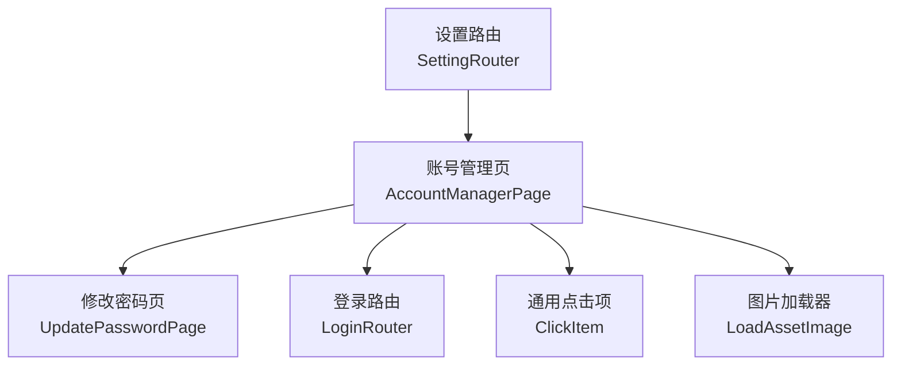
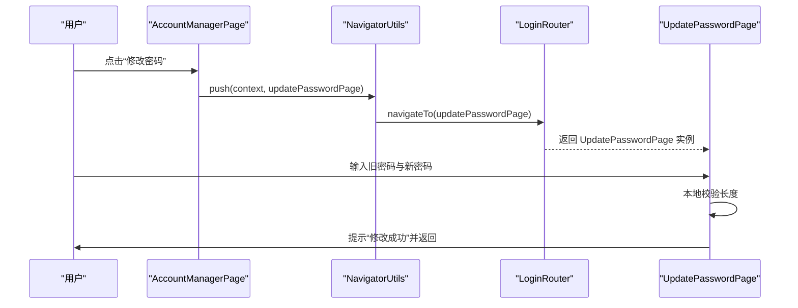
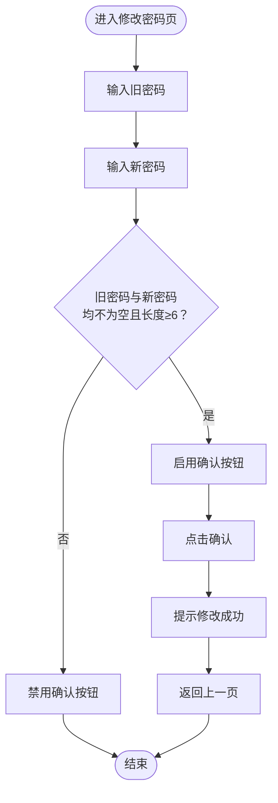
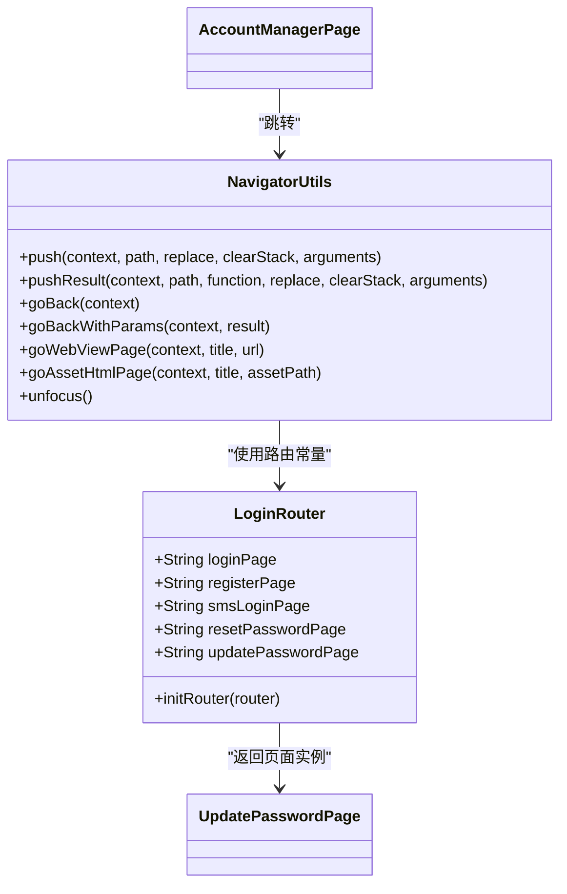
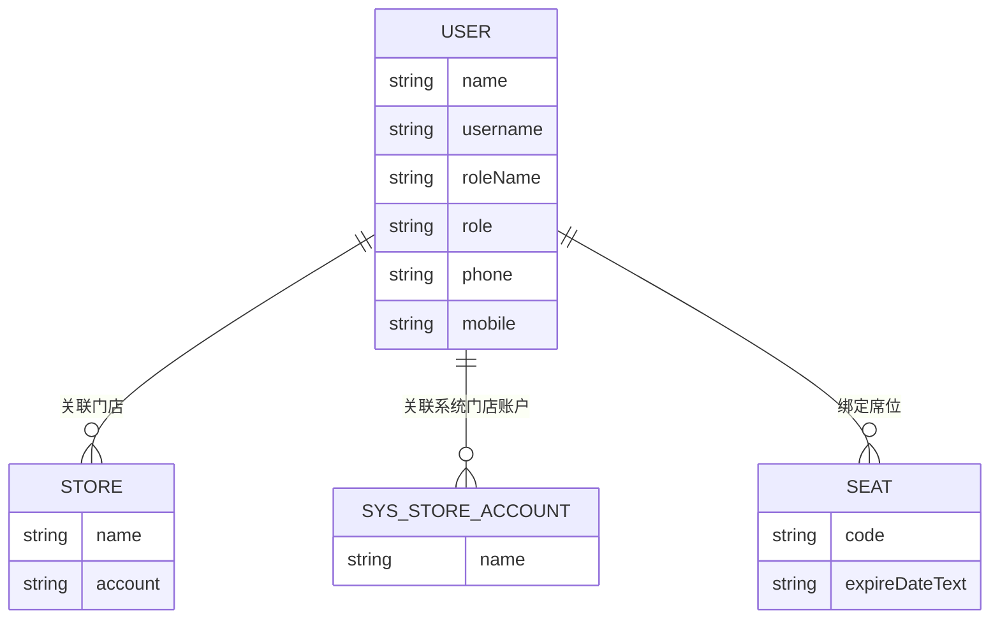
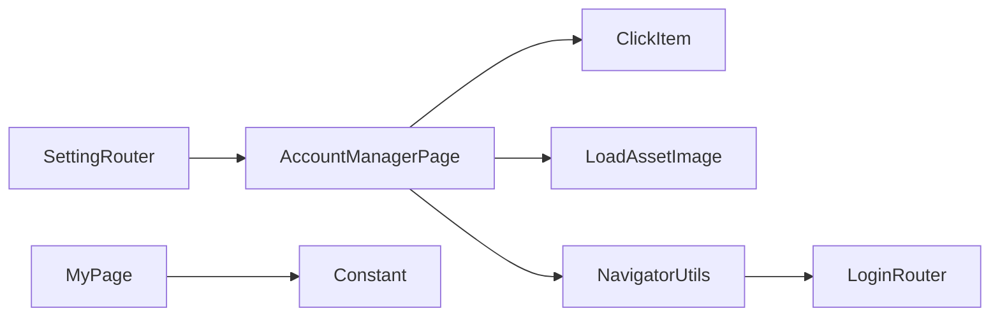

# 账户管理

<cite>
**本文引用的文件**
- [account_manager_page.dart](file://lib/setting/page/account_manager_page.dart)
- [setting_router.dart](file://lib/setting/setting_router.dart)
- [login_router.dart](file://lib/pages/login/login_router.dart)
- [update_password_page.dart](file://lib/pages/login/page/update_password_page.dart)
- [my_page.dart](file://lib/pages/home/my_page.dart)
- [constant.dart](file://lib/res/constant.dart)
- [click_item.dart](file://lib/widgets/click_item.dart)
- [load_image.dart](file://lib/widgets/load_image.dart)
- [fluro_navigator.dart](file://lib/routers/fluro_navigator.dart)
</cite>

## 目录
1. [引言](#引言)
2. [项目结构定位](#项目结构定位)
3. [核心组件总览](#核心组件总览)
4. [架构与数据流](#架构与数据流)
5. [详细组件分析](#详细组件分析)
6. [依赖关系分析](#依赖关系分析)
7. [性能与可维护性](#性能与可维护性)
8. [扩展指南](#扩展指南)
9. [用户体验优化建议](#用户体验优化建议)
10. [错误处理策略](#错误处理策略)
11. [结论](#结论)

## 引言
本文围绕灵犀管店 Flutter 项目的“账户管理”能力展开，重点说明 AccountManagerPage 的功能实现现状、与登录模块的集成方式、账户信息在本地存储中的结构与更新机制，并在此基础上给出密码修改流程的安全性分析、账户管理功能扩展指南、用户体验优化建议与错误处理策略。目标是帮助开发者在不直接阅读源码的情况下理解该模块的职责边界、交互路径和后续改造方向。

## 项目结构定位
账户管理入口位于设置模块中，通过设置路由注册到应用全局路由表；账户管理页面本身是一个轻量级列表，提供店铺 logo、修改密码、绑定账号等条目。其中：
- 店铺 logo 条目目前仅展示占位图，未实现实际选择与上传逻辑。
- 修改密码条目跳转到登录模块的密码修改页。
- 绑定账号条目为静态展示，未对接真实接口。

图表来源
- [setting_router.dart:1-24](file://lib/setting/setting_router.dart#L1-L24)
- [account_manager_page.dart:1-54](file://lib/setting/page/account_manager_page.dart#L1-L54)
- [login_router.dart:1-28](file://lib/pages/login/login_router.dart#L1-L28)
- [click_item.dart:1-73](file://lib/widgets/click_item.dart#L1-L73)
- [load_image.dart:1-94](file://lib/widgets/load_image.dart#L1-L94)

章节来源
- [setting_router.dart:1-24](file://lib/setting/setting_router.dart#L1-L24)
- [account_manager_page.dart:1-54](file://lib/setting/page/account_manager_page.dart#L1-L54)

## 核心组件总览
- AccountManagerPage：账户管理主页面，负责展示店铺 logo、修改密码、绑定账号三个条目。
- UpdatePasswordPage：修改密码页面，包含旧密码与新密码输入框、本地校验与确认按钮。
- LoginRouter：登录相关路由定义，包括注册、短信登录、重置密码、修改密码等。
- ClickItem：通用可点击条目组件，用于构建列表项标题、内容与箭头指示。
- LoadAssetImage / LoadImage：资源图片与网络图片加载封装。
- NavigatorUtils：基于 Fluro 的路由跳转工具方法。
- MyPage 与 Constant：个人中心与本地常量，定义了用户、门店、系统门店账户与席位等本地存储键，体现了账户信息的持久化结构。

章节来源
- [account_manager_page.dart:1-54](file://lib/setting/page/account_manager_page.dart#L1-L54)
- [update_password_page.dart:1-108](file://lib/pages/login/page/update_password_page.dart#L1-L108)
- [login_router.dart:1-28](file://lib/pages/login/login_router.dart#L1-L28)
- [click_item.dart:1-73](file://lib/widgets/click_item.dart#L1-L73)
- [load_image.dart:1-94](file://lib/widgets/load_image.dart#L1-L94)
- [fluro_navigator.dart:1-72](file://lib/routers/fluro_navigator.dart#L1-L72)
- [my_page.dart:1-400](file://lib/pages/home/my_page.dart#L1-L400)
- [constant.dart:23-29](file://lib/res/constant.dart#L23-L29)

## 架构与数据流
账户管理功能在当前代码库中表现为“弱后端依赖”的界面组合：
- AccountManagerPage 通过 ClickItem 渲染条目；
- “修改密码”通过 NavigatorUtils.push 调用 LoginRouter.updatePasswordPage 路由；
- “店铺 logo”与“绑定账号”尚未实现具体业务逻辑，仅作为占位 UI；
- 账户相关信息（用户、门店、系统门店账户、席位）主要保存在本地存储中，由 MyPage 读取与刷新。

图表来源
- [account_manager_page.dart:1-54](file://lib/setting/page/account_manager_page.dart#L1-L54)
- [fluro_navigator.dart:1-72](file://lib/routers/fluro_navigator.dart#L1-L72)
- [login_router.dart:1-28](file://lib/pages/login/login_router.dart#L1-L28)
- [update_password_page.dart:1-108](file://lib/pages/login/page/update_password_page.dart#L1-L108)

## 详细组件分析

### AccountManagerPage：账户管理主页面
职责与行为
- 使用 MyAppBar 显示“账号管理”标题。
- 使用 Column 排列三个条目：店铺 logo、修改密码、绑定账号。
- 店铺 logo 使用 Stack + ClickItem + LoadAssetImage 展示占位图标，onTap 为空。
- 修改密码使用 ClickItem 并调用 NavigatorUtils.push 打开 LoginRouter.updatePasswordPage。
- 绑定账号使用静态 ClickItem 展示示例手机号，无跳转或接口调用。

UI 组成要点
- ClickItem：统一标题、内容、右侧箭头样式，支持可选 onTap。
- LoadAssetImage：从 assets 加载资源图片，当前使用 shop/tx 占位。
- NavigatorUtils：封装 Fluro 导航，避免重复写路由参数与过渡动画。

改进建议
- 将店铺 logo 改为可点击选择图片并调用后端上传接口，成功后更新本地缓存并在头像处展示。
- 将绑定账号改为可编辑或解绑操作，接入后端绑定/解绑接口，并进行状态同步。
- 对静态占位文案增加空态提示，例如当绑定账号为空时显示“暂未绑定”。

章节来源
- [account_manager_page.dart:1-54](file://lib/setting/page/account_manager_page.dart#L1-L54)
- [click_item.dart:1-73](file://lib/widgets/click_item.dart#L1-L73)
- [load_image.dart:1-94](file://lib/widgets/load_image.dart#L1-L94)
- [fluro_navigator.dart:1-72](file://lib/routers/fluro_navigator.dart#L1-L72)

### UpdatePasswordPage：修改密码页面
职责与行为
- 提供“旧密码”“新密码”两个密码输入框。
- 监听控制器变化，执行本地校验：旧密码和新密码均不能为空且长度不小于 6。
- 校验通过后启用“确认”按钮，点击后显示“修改成功”提示并返回上一页。

安全与健壮性现状
- 前端仅做基础非空与长度校验，未进行复杂度规则（大小写、数字、特殊字符）校验。
- 未调用后端接口进行密码修改，也没有二次确认、验证码或会话校验。
- 未对用户输入进行脱敏或防重复提交控制。

安全性建议
- 引入密码强度校验规则，并在输入过程中实时反馈。
- 接入后端修改密码接口，要求携带当前会话凭据，并在服务端进行密码加密与权限校验。
- 增加二次确认弹窗或短信验证码步骤，防止误操作。
- 对提交过程添加防抖与禁用按钮，避免重复提交。
- 失败时展示明确错误信息，如“旧密码不正确”“新密码不符合规则”。

图表来源
- [update_password_page.dart:1-108](file://lib/pages/login/page/update_password_page.dart#L1-L108)

章节来源
- [update_password_page.dart:1-108](file://lib/pages/login/page/update_password_page.dart#L1-L108)

### 登录路由与导航
- LoginRouter 定义了 loginPage、registerPage、smsLoginPage、resetPasswordPage、updatePasswordPage 五个路由常量，并在 initRouter 中完成注册。
- AccountManagerPage 通过 NavigatorUtils.push(context, LoginRouter.updatePasswordPage) 触发路由跳转。
- NavigatorUtils 内部使用 Routes.router.navigateTo 并设置原生转场动画，同时支持参数传递与返回结果回调。

图表来源
- [login_router.dart:1-28](file://lib/pages/login/login_router.dart#L1-L28)
- [fluro_navigator.dart:1-72](file://lib/routers/fluro_navigator.dart#L1-L72)
- [account_manager_page.dart:1-54](file://lib/setting/page/account_manager_page.dart#L1-L54)
- [update_password_page.dart:1-108](file://lib/pages/login/page/update_password_page.dart#L1-L108)

章节来源
- [login_router.dart:1-28](file://lib/pages/login/login_router.dart#L1-L28)
- [fluro_navigator.dart:1-72](file://lib/routers/fluro_navigator.dart#L1-L72)
- [account_manager_page.dart:1-54](file://lib/setting/page/account_manager_page.dart#L1-L54)

### 账户信息与本地存储结构
MyPage 展示了账户相关数据的读取方式与字段映射，结合 Constant 中的本地存储键，可以总结账户信息的存储结构如下：
- user：用户信息 JSON，包含 name、username、roleName、role、phone、mobile 等字段。
- store：门店信息 JSON，包含 name、account 等字段。
- sysStoreAccount：系统门店账户 JSON，包含 name 等字段。
- sysSeat：席位信息 JSON，包含 code、过期时间格式化后的文本等。

更新机制
- MyPage 在 initState 中调用 _loadUserInfo 从 SpUtil.getString 读取上述键值，并解析为 Map。
- 在增值服务拉取或席位刷新等操作完成后，会重新加载用户信息以刷新 UI。
- 解绑席位后，会清空本地席位缓存并重新拉取员工门店权限。

图表来源
- [my_page.dart:1-400](file://lib/pages/home/my_page.dart#L1-L400)
- [constant.dart:23-29](file://lib/res/constant.dart#L23-L29)

章节来源
- [my_page.dart:1-400](file://lib/pages/home/my_page.dart#L1-L400)
- [constant.dart:23-29](file://lib/res/constant.dart#L23-L29)

## 依赖关系分析
AccountManagerPage 的直接依赖如下：
- 路由层：LoginRouter 提供修改密码路由常量；SettingRouter 注册 AccountManagerPage 到全局路由。
- 导航层：NavigatorUtils 提供统一的 push/goBack 等方法。
- UI 层：ClickItem 提供列表项展示；LoadAssetImage 提供本地资源图片。
- 账户数据层：MyPage 与 Constant 体现账户信息的本地存储键与字段映射，但 AccountManagerPage 当前未直接访问这些键。

图表来源
- [account_manager_page.dart:1-54](file://lib/setting/page/account_manager_page.dart#L1-L54)
- [setting_router.dart:1-24](file://lib/setting/setting_router.dart#L1-L24)
- [login_router.dart:1-28](file://lib/pages/login/login_router.dart#L1-L28)
- [fluro_navigator.dart:1-72](file://lib/routers/fluro_navigator.dart#L1-L72)
- [click_item.dart:1-73](file://lib/widgets/click_item.dart#L1-L73)
- [load_image.dart:1-94](file://lib/widgets/load_image.dart#L1-L94)
- [my_page.dart:1-400](file://lib/pages/home/my_page.dart#L1-L400)
- [constant.dart:23-29](file://lib/res/constant.dart#L23-L29)

章节来源
- [account_manager_page.dart:1-54](file://lib/setting/page/account_manager_page.dart#L1-L54)
- [setting_router.dart:1-24](file://lib/setting/setting_router.dart#L1-L24)
- [login_router.dart:1-28](file://lib/pages/login/login_router.dart#L1-L28)
- [fluro_navigator.dart:1-72](file://lib/routers/fluro_navigator.dart#L1-L72)
- [click_item.dart:1-73](file://lib/widgets/click_item.dart#L1-L73)
- [load_image.dart:1-94](file://lib/widgets/load_image.dart#L1-L94)
- [my_page.dart:1-400](file://lib/pages/home/my_page.dart#L1-L400)
- [constant.dart:23-29](file://lib/res/constant.dart#L23-L29)

## 性能与可维护性
- AccountManagerPage 结构简单，Widget 树较浅，无明显性能瓶颈。
- ClickItem 复用良好，适合扩展新的账户设置项。
- LoadAssetImage 使用 Image.asset，适合本地小图标；若未来支持网络头像，应优先使用 LoadImage 的网络加载能力并配合缓存。
- 路由跳转统一使用 NavigatorUtils，有助于保持导航行为一致。

可维护性建议
- 将“店铺 logo”“绑定账号”等业务逻辑下沉到独立的服务类或 Provider，便于测试与复用。
- 将密码修改逻辑从页面内联校验迁移至专门的验证器，提升规则可配置性与可测试性。
- 对静态占位文案与硬编码手机号进行集中管理，避免散落字符串难以维护。

[本节为通用指导，不直接分析具体文件]

## 扩展指南

### 新增账户设置项
步骤建议
- 在 AccountManagerPage 的 Column 中新增一个 ClickItem 条目。
- 如果需要跳转，使用 NavigatorUtils.push(context, '你的路由')。
- 如果需要在列表中显示当前值，使用 ClickItem 的 content 参数展示。
- 若需要与本地存储联动，参考 MyPage 中读取 Constant.user / Constant.store / Constant.sysStoreAccount / Constant.sysSeat 的方式，从 SpUtil 获取并解析。

注意事项
- 新增条目应遵循现有 ClickItem 的视觉规范，保持一致的对齐与间距。
- 对于敏感操作（如解绑账号、修改密码），应在页面内或弹窗中进行二次确认。

章节来源
- [account_manager_page.dart:1-54](file://lib/setting/page/account_manager_page.dart#L1-L54)
- [click_item.dart:1-73](file://lib/widgets/click_item.dart#L1-L73)
- [my_page.dart:1-400](file://lib/pages/home/my_page.dart#L1-L400)
- [constant.dart:23-29](file://lib/res/constant.dart#L23-L29)

### 集成第三方账户服务
建议方案
- 抽象账户服务接口，定义绑定/解绑、查询绑定状态、修改密码等方法。
- 在 AccountManagerPage 中注入该服务，调用其 API 完成业务。
- 对第三方 SDK 初始化与生命周期管理放在独立模块，避免污染页面逻辑。
- 对错误进行统一处理，使用 Toast 或 Dialog 向用户反馈。

安全传输建议
- 所有请求走 HTTPS，确保传输层安全。
- 敏感字段（如密码、验证码）不在日志中输出。
- 在服务层进行参数签名与鉴权，避免客户端绕过。

[本节为通用指导，不直接分析具体文件]

## 用户体验优化建议
- 店铺 logo：
  - 点击后弹出底部选择器，支持从相册选取或拍照。
  - 上传前进行压缩与格式校验，上传中显示进度，失败时允许重试。
  - 成功后立即刷新头像，并提供撤销最近一次更改的能力。
- 修改密码：
  - 实时显示密码强度与规则提示。
  - 对“旧密码不正确”“网络异常”“服务器拒绝”等错误进行差异化提示。
  - 修改成功后自动返回，并可考虑跳转到登录页引导用户用新密码重新登录。
- 绑定账号：
  - 未绑定时显示“去绑定”，绑定后显示掩码手机号与“解绑”操作。
  - 解绑前弹出确认对话框，解绑成功后刷新列表并提示。

[本节为通用指导，不直接分析具体文件]

## 错误处理策略
当前现状
- UpdatePasswordPage 在点击确认后直接提示“修改成功”，没有错误分支。
- AccountManagerPage 的店铺 logo 与绑定账号没有业务逻辑，因此没有错误场景。
- 其他页面如 MyPage 在接口异常时依赖 http_helper 的统一提示。

改进建议
- 在 UpdatePasswordPage 中将“修改成功”替换为真正的后端调用，并对失败进行 catch 处理。
- 使用统一的错误提示工具，区分网络错误、业务错误与系统错误。
- 在 AccountManagerPage 中为“店铺 logo”“绑定账号”预留错误状态展示位置，例如失败重试按钮或错误文案。
- 对敏感操作增加防重复提交与超时处理，避免用户多次点击导致状态不一致。

章节来源
- [update_password_page.dart:1-108](file://lib/pages/login/page/update_password_page.dart#L1-L108)
- [account_manager_page.dart:1-54](file://lib/setting/page/account_manager_page.dart#L1-L54)
- [my_page.dart:1-400](file://lib/pages/home/my_page.dart#L1-L400)

## 结论
当前 AccountManagerPage 主要承担账户管理的入口展示职责，已打通“修改密码”的路由跳转，但未实现店铺 logo 管理与绑定账号的真实业务逻辑。账户信息通过 MyPage 与 Constant 定义的本地存储键进行读取与刷新，整体结构清晰、可扩展性强。建议在后续迭代中补齐店铺 logo 上传、绑定/解绑账号与密码修改的后端对接，完善密码强度校验与安全传输，并通过统一错误处理与用户体验优化，使账户管理模块更加完整与稳定。