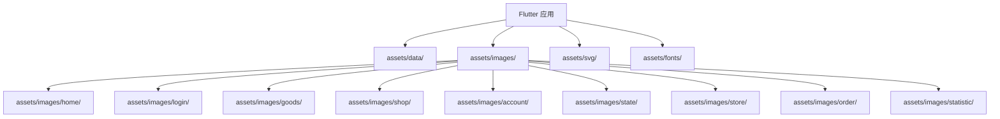
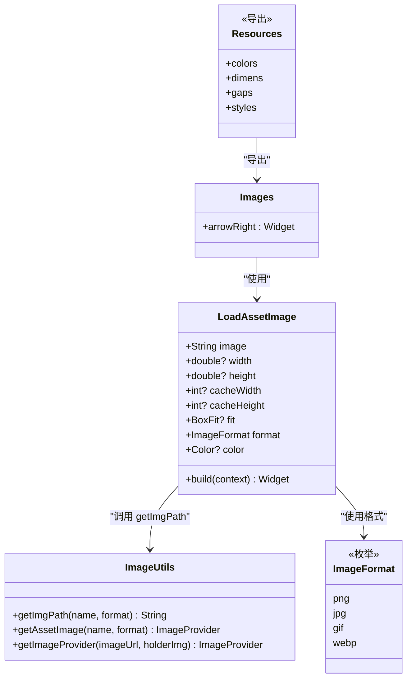
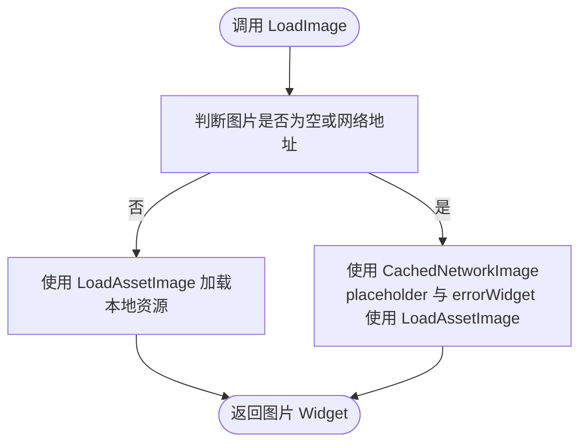
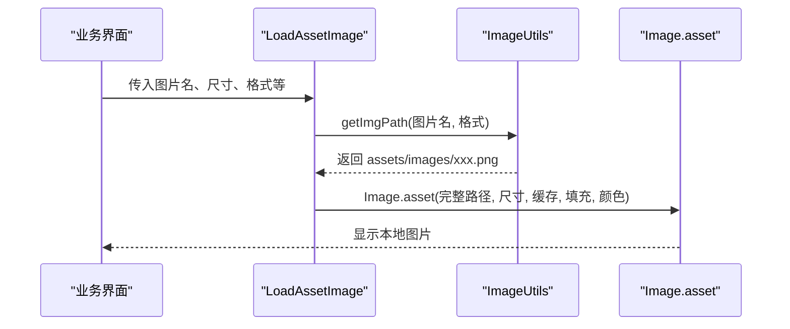
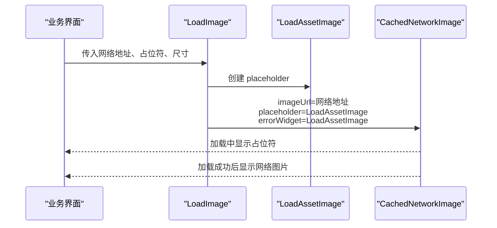

# 资源管理

<cite>
**本文引用的文件**   
- [resources.dart](file://lib/res/resources.dart)
- [load_image.dart](file://lib/widgets/load_image.dart)
- [image_utils.dart](file://lib/util/image_utils.dart)
- [pubspec.yaml](file://pubspec.yaml)
</cite>

## 目录
1. [简介](#简介)
2. [项目结构中的静态资源](#项目结构中的静态资源)
3. [核心组件总览](#核心组件总览)
4. [Resources 与 Images 的作用](#resources-与-images-的作用)
5. [LoadAssetImage 组件详解](#loadassetimage-组件详解)
6. [图片加载流程与优化](#图片加载流程与优化)
7. [资源组织与命名规范](#资源组织与命名规范)
8. [多分辨率适配与国际化](#多分辨率适配与国际化)
9. [最佳实践清单](#最佳实践清单)
10. [常见问题排查](#常见问题排查)
11. [结论](#结论)

## 简介
本文面向灵犀管店 Flutter 项目的资源管理，重点说明：
- `Resources` 包中 `Images` 类如何集中暴露应用图标。
- `LoadAssetImage` 组件如何统一加载本地图片、处理尺寸、缓存和语义信息。
- 如何通过 `ImageUtils` 解析图片路径、统一格式枚举，并对外提供统一的 `ImageProvider`。
- 如何在 `pubspec.yaml` 中声明静态资源目录。
- 如何组织图片、字体、图标等静态资源，并提供命名、格式、性能方面的最佳实践。
- 如何处理多分辨率图片和国际化资源。

## 项目结构中的静态资源
项目根目录下的 `assets` 目录是 Flutter 静态资源的入口，包含：
- `assets/data/`：业务数据与协议文本，例如银行列表、隐私政策、用户协议、排序配置等。
- `assets/images/`：业务图片，按功能域进一步拆分，如 `home`、`login`、`goods`、`shop`、`account`、`state`、`store`、`order`、`statistic` 等。
- `assets/svg/`：SVG 矢量图标。
- `assets/fonts/`：自定义字体文件（在 `pubspec.yaml` 中声明）。

在 `pubspec.yaml` 的 `flutter.assets` 中已注册多个图片子目录，确保构建时将这些资源打包进应用。同时，`fonts` 字段中已添加一个名为 `RobotoThin` 的自定义字体，指向 `assets/fonts/Roboto-Thin.ttf`。

**图表来源**  
- [pubspec.yaml:120-153](file://pubspec.yaml#L120-L153)

**章节来源**  
- [pubspec.yaml:120-153](file://pubspec.yaml#L120-L153)

## 核心组件总览
本项目围绕三类资源相关代码组织资源访问：
- `lib/res/resources.dart`：导出颜色、尺寸、间距、样式，并定义 `Images` 类，集中暴露常用图标。
- `lib/widgets/load_image.dart`：封装本地图片加载组件 `LoadAssetImage`，以及网络图片加载组件 `LoadImage`。
- `lib/util/image_utils.dart`：提供图片路径拼接、格式枚举和通用 `ImageProvider` 获取方法。

**图表来源**  
- [resources.dart:1-12](file://lib/res/resources.dart#L1-L12)
- [load_image.dart:1-94](file://lib/widgets/load_image.dart#L1-L94)
- [image_utils.dart:1-34](file://lib/util/image_utils.dart#L1-L34)

**章节来源**  
- [resources.dart:1-12](file://lib/res/resources.dart#L1-L12)
- [load_image.dart:1-94](file://lib/widgets/load_image.dart#L1-L94)
- [image_utils.dart:1-34](file://lib/util/image_utils.dart#L1-L34)

## Resources 与 Images 的作用
### Resources 包
`lib/res/resources.dart` 主要承担以下职责：
- 集中导出全局设计资源，包括颜色、尺寸、间距、样式。
- 将 `Images` 类作为应用图标的唯一出口，便于统一管理和复用。

该文件还引入 `LoadAssetImage`，说明图标加载统一走该组件，而不是直接在页面中使用 `Image.asset`。

### Images 类
`Images` 是一个简单容器类，用于暴露应用内常用图标常量。当前示例暴露了右箭头图标 `arrowRight`，其值是一个预配置的 `LoadAssetImage` 组件实例，指定了图片名称、宽高。

这样做的优势是：
- 业务页面不需要关心图标具体路径和尺寸细节。
- 修改图标路径或默认尺寸时，只需改 `Images` 一处。
- 图标以 `const Widget` 形式暴露，有利于 Flutter 渲染树优化。

**章节来源**  
- [resources.dart:1-12](file://lib/res/resources.dart#L1-L12)

## LoadAssetImage 组件详解
`LoadAssetImage` 是本地图片加载的核心组件，位于 `lib/widgets/load_image.dart`。它的主要特点如下：

| 能力 | 说明 |
| --- | --- |
| 本地图片加载 | 通过 `ImageUtils.getImgPath` 生成完整路径，再交给 `Image.asset` 加载。 |
| 尺寸控制 | 支持传入 `width`、`height`，直接设置到 `Image.asset`。 |
| 内存缓存优化 | 支持 `cacheWidth`、`cacheHeight`，用于控制解码后内存图像大小，避免大图占用过多内存。 |
| 布局填充模式 | 支持 `fit`，可指定图片缩放策略。 |
| 格式支持 | 通过 `format` 参数选择图片后缀，默认 PNG。 |
| 主题着色 | 支持 `color`，方便对图标进行主题色覆盖。 |
| 语义信息 | 显式设置 `excludeFromSemantics: true`，表示这类装饰性图片不参与无障碍语义树，减少不必要的屏幕阅读器负担。 |

此外，同文件中的 `LoadImage` 组件负责区分本地图片与网络图片：
- 如果传入的图片为空或以 `http` 开头，则走网络图片加载逻辑，并使用 `CachedNetworkImage`。
- 网络图片加载时使用 `LoadAssetImage` 作为占位符和错误回退。
- 否则直接委托给 `LoadAssetImage` 加载本地资源。

**图表来源**  
- [load_image.dart:1-94](file://lib/widgets/load_image.dart#L1-L94)

**章节来源**  
- [load_image.dart:1-94](file://lib/widgets/load_image.dart#L1-L94)

## 图片加载流程与优化
### 本地图片路径解析
`ImageUtils.getImgPath` 会将业务层传入的图片名转换为完整路径，规则是：
- 基础目录：`assets/images/`
- 文件名：`{name}.{format.value}`
- 默认格式：PNG

因此，业务代码通常只需要传入相对 `assets/images/` 的路径，例如 `home/logo`，最终会被解析为 `assets/images/home.logo.png`。

### 本地图片加载流程

**图表来源**  
- [load_image.dart:59-94](file://lib/widgets/load_image.dart#L59-L94)
- [image_utils.dart:1-34](file://lib/util/image_utils.dart#L1-L34)

### 网络图片加载流程
当业务使用 `LoadImage` 且传入网络地址时：
1. 判断为空或以 `http` 开头。
2. 构造占位符 Widget，通常是 `LoadAssetImage('none', ...)`。
3. 使用 `CachedNetworkImage` 加载网络图片。
4. 加载失败时回退到占位符。
5. 成功时显示网络图片，并可配置 `memCacheWidth`、`memCacheHeight` 控制内存缓存大小。

**图表来源**  
- [load_image.dart:1-58](file://lib/widgets/load_image.dart#L1-L58)

**章节来源**  
- [load_image.dart:1-94](file://lib/widgets/load_image.dart#L1-L94)
- [image_utils.dart:1-34](file://lib/util/image_utils.dart#L1-L34)

## 资源组织与命名规范
### 推荐目录结构
根据现有仓库结构，建议遵循以下原则：
- 业务图片放在 `assets/images/<业务域>/`，例如 `home`、`login`、`goods`、`shop`、`account`、`state`、`store`、`order`、`statistic`。
- 矢量图标优先使用 SVG，放在 `assets/svg/`，并由专门的 SVG 组件或工具统一加载。
- 自定义字体放在 `assets/fonts/`，并在 `pubspec.yaml` 中声明 `family` 和 `asset`。
- 非图片静态数据放在 `assets/data/`，例如 JSON、HTML 协议文本。

### 命名规范
- 图片名使用小写英文字母、数字和下划线，例如 `ic_arrow_right`、`order_search`、`account_wechat`。
- 路径体现业务含义，例如 `account/yhk` 表示账户页银行卡图标，`state/zwsp` 表示状态页空白占位图。
- 不要使用中文作为资源文件名，避免跨平台兼容问题。
- 公共图标建议在 `Images` 中集中暴露，例如 `Images.arrowRight`。

### 格式选择
- 普通照片类资源推荐使用 `jpg` 或 `webp`，体积更小。
- 需要透明背景或精细线条的图标推荐使用 `png` 或 `svg`。
- 动画图片使用 `gif`，但注意 GIF 体积较大，必要时考虑视频或 Lottie。
- 项目默认使用 `png`，可通过 `ImageFormat` 枚举切换。

**章节来源**  
- [pubspec.yaml:120-153](file://pubspec.yaml#L120-L153)
- [image_utils.dart:1-34](file://lib/util/image_utils.dart#L1-L34)

## 多分辨率适配与国际化
### 多分辨率图片适配
Flutter 官方支持按像素密度放置多倍率图片，例如：
- `assets/images/icon.png`
- `assets/images/icon@2x.png`
- `assets/images/icon@3x.png`

使用时仍按同一逻辑名引用，Flutter 会根据设备像素密度自动选择合适的图片。

当前项目中，`assets/images/store/` 下出现了 `2.0x`、`3.0x` 子目录，这说明部分资源已经按倍数目录组织。需要注意的是：
- 如果使用 `ImageUtils.getImgPath` 生成固定路径，应确保对应倍率图片存在。
- 更稳妥的方式是将多倍率图片放在同一层级，并按 `@2x`、`@3x` 命名；或者针对特定场景使用 `AssetImage` 配合 `AssetBundle` 指定精确路径。
- 对于 `LoadAssetImage`，由于路径由 `ImageUtils` 拼接，新增多倍率资源时应检查是否影响已有调用。

### 国际化资源处理
当前仓库中未发现标准的 Flutter 国际化资源文件（如 `arb` 文件或纯文本翻译文件），但依赖了 `flutter_localizations` 和 `intl`。结合项目结构，国际化资源可参考以下组织方式：
- 文案翻译：新增 `assets/i18n/`，按语言代码划分，例如 `zh_CN.json`、`en_US.json`。
- 动态内容：如隐私协议、用户协议，可继续放在 `assets/data/`，并通过 `rootBundle.loadString` 读取 HTML 或 JSON。
- 字体国际化：不同地区可能需要不同字体，可在 `pubspec.yaml` 的 `fonts` 中按需配置多套字体族。

本项目当前的国际化重点不在资源文件本身，而在运行时语言选择和文本格式化。

**章节来源**  
- [pubspec.yaml:120-153](file://pubspec.yaml#L120-L153)

## 最佳实践清单
### 资源访问
- 优先使用 `Images` 暴露常用图标，减少散落的字符串路径。
- 使用 `LoadAssetImage` 加载本地图片，避免在各页面重复实现尺寸、缓存、语义逻辑。
- 网络图片使用 `LoadImage`，利用内置占位符和错误回退机制。
- 使用 `ImageUtils.getImgPath` 或 `getAssetImage` 统一生成路径和 `ImageProvider`。

### 性能优化
- 为大型图片设置 `cacheWidth`、`cacheHeight`，避免解码出过大的内存图像。
- 对缩略图、列表项图片使用较小缓存尺寸。
- 网络图片开启 `CachedNetworkImage`，避免重复下载。
- 合理使用图片格式，照片用 `jpg` 或 `webp`，图标用 `png` 或 `svg`。
- 对装饰性图标启用 `excludeFromSemantics`，减少无障碍开销。

### 资源管理
- 所有静态资源必须在 `pubspec.yaml` 的 `flutter.assets` 中声明。
- 新增图片目录后，务必同步更新 `pubspec.yaml`。
- 图标命名保持语义清晰，路径反映业务模块。
- 公共图标集中在 `Images`，避免多处硬编码路径。

### 多分辨率与国际化
- 多倍率图片按 Flutter 约定命名，或使用倍数目录时确保路径一致。
- 国际化文案与协议文本分开管理，协议文本可继续使用 `assets/data/`。
- 字体在 `pubspec.yaml` 中声明，并明确 `family` 名称。

**章节来源**  
- [resources.dart:1-12](file://lib/res/resources.dart#L1-L12)
- [load_image.dart:1-94](file://lib/widgets/load_image.dart#L1-L94)
- [image_utils.dart:1-34](file://lib/util/image_utils.dart#L1-L34)
- [pubspec.yaml:120-153](file://pubspec.yaml#L120-L153)

## 常见问题排查
### 图片无法显示
- 检查 `pubspec.yaml` 是否声明了对应 `assets/images/...` 目录。
- 检查图片路径是否与 `ImageUtils.getImgPath` 生成的路径一致。
- 确认图片格式与 `ImageFormat` 枚举匹配。
- 如果是多倍率图片，确认对应倍率文件是否存在。

### 图片内存过大
- 为 `LoadAssetImage` 或 `LoadImage` 传入合适的 `cacheWidth`、`cacheHeight`。
- 对大图先压缩，再放入资源目录。
- 列表页中避免加载原始分辨率图片。

### 网络图片加载失败
- 检查 URL 是否有效。
- 检查 `LoadImage` 的占位符和错误回退是否配置正确。
- 确认网络权限和代理配置正常。

### 图标颜色不生效
- 确认传入的 `color` 不是透明或与背景融合。
- 确认图片本身不是带固定颜色的位图，必要时改用 SVG 或单色 PNG。

**章节来源**  
- [load_image.dart:1-94](file://lib/widgets/load_image.dart#L1-L94)
- [image_utils.dart:1-34](file://lib/util/image_utils.dart#L1-L34)
- [pubspec.yaml:120-153](file://pubspec.yaml#L120-L153)

## 结论
灵犀管店 Flutter 项目的资源管理以 `Images` 为图标入口，以 `LoadAssetImage` 为本地图片加载标准组件，以 `ImageUtils` 为路径和提供者工具，以 `pubspec.yaml` 为静态资源声明中心。这种分层使业务页面无需关心底层资源细节，既能提升一致性，也便于优化性能和扩展国际化。

在实际开发中，应坚持：
- 统一资源入口和加载组件。
- 规范命名和目录结构。
- 合理选择图片格式和缓存策略。
- 在 `pubspec.yaml` 中维护好静态资源声明。
- 在多分辨率和国际化场景中保持一致的资源访问方式。