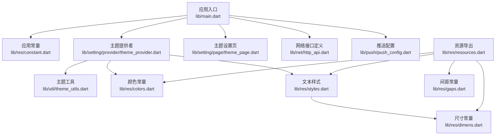
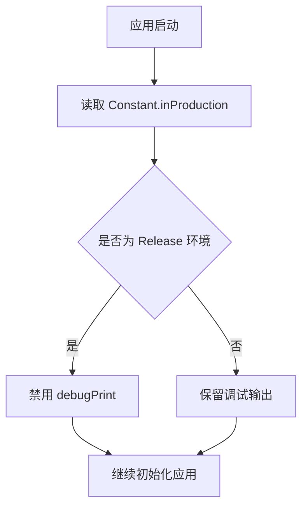
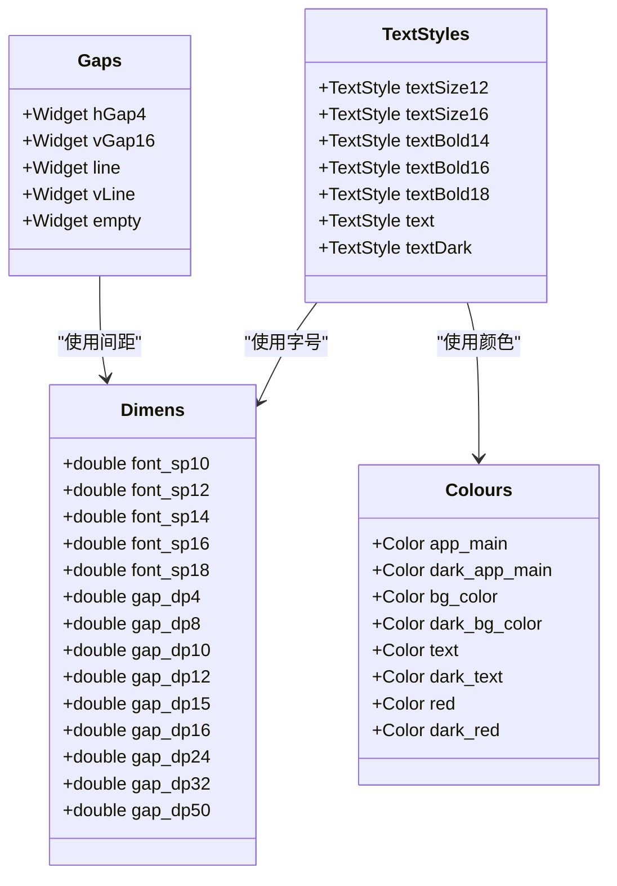
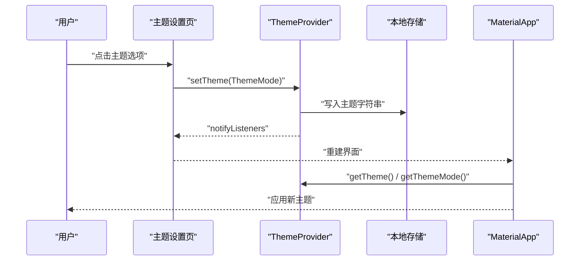
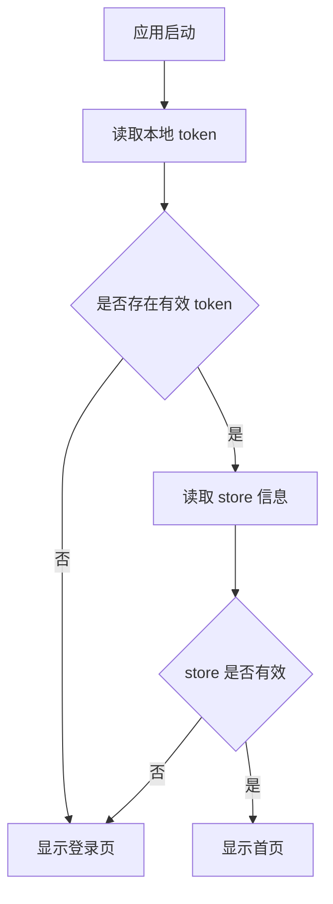
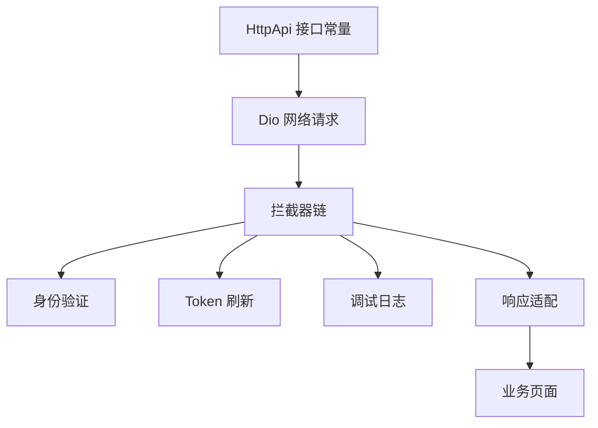
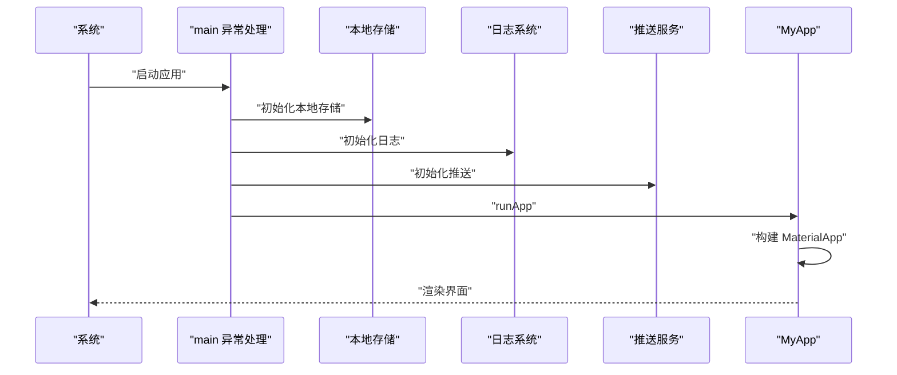

# 配置与定制

<cite>
**本文引用的文件**   
- [lib/main.dart](file://lib/main.dart)
- [pubspec.yaml](file://pubspec.yaml)
- [lib/res/constant.dart](file://lib/res/constant.dart)
- [lib/res/dimens.dart](file://lib/res/dimens.dart)
- [lib/res/resources.dart](file://lib/res/resources.dart)
- [lib/res/styles.dart](file://lib/res/styles.dart)
- [lib/res/colors.dart](file://lib/res/colors.dart)
- [lib/res/gaps.dart](file://lib/res/gaps.dart)
- [lib/setting/page/theme_page.dart](file://lib/setting/page/theme_page.dart)
- [lib/setting/provider/theme_provider.dart](file://lib/setting/provider/theme_provider.dart)
- [lib/util/theme_utils.dart](file://lib/util/theme_utils.dart)
- [lib/setting/page/account_manager_page.dart](file://lib/setting/page/account_manager_page.dart)
- [lib/net/http_api.dart](file://lib/net/http_api.dart)
- [lib/push/push_config.dart](file://lib/push/push_config.dart)
</cite>

## 目录

1. [引言](#引言)
2. [项目结构与定位](#项目结构与定位)
3. [应用常量与环境配置](#应用常量与环境配置)
4. [尺寸适配与间距系统](#尺寸适配与间距系统)
5. [主题系统与动态切换](#主题系统与动态切换)
6. [账户管理与登录配置](#账户管理与登录配置)
7. [网络接口与后端环境配置](#网络接口与后端环境配置)
8. [推送服务与平台特定配置](#推送服务与平台特定配置)
9. [国际化与语言设置](#国际化与语言设置)
10. [动态配置更新机制](#动态配置更新机制)
11. [依赖、版本与资源管理](#依赖版本与资源管理)
12. [性能影响评估](#性能影响评估)
13. [最佳实践与变更建议](#最佳实践与变更建议)
14. [常见问题排查](#常见问题排查)
15. [总结](#总结)

## 引言

本文件面向灵犀管店 Flutter 项目的开发者，系统性梳理应用的配置体系与可定制点。重点覆盖：

- **应用常量配置**：运行环境判断、本地存储键名、图片前缀等。
- **尺寸适配**：字号、间距、分隔线的统一规范。
- **主题系统**：明暗主题、Material 主题构建、状态栏样式和字体缩放控制。
- **账户管理**：账号管理页面入口、登录相关本地存储键。
- **环境变量与平台设置**：网络基地址、极光推送 AppKey、渠道标识、iOS 生产环境开关。
- **国际化支持**：当前语言、本地化委托和受支持区域。
- **动态配置更新**：主题持久化、Provider 通知、启动初始化流程。

文档同时给出配置修改方法、依赖关系图、关键流程图以及性能与版本管理建议，帮助在不同部署环境中完成行为与外观的自定义。

## 项目结构与定位

从代码组织看，配置类主要位于以下位置：

| 模块 | 路径 | 职责 |
| --- | --- | --- |
| 应用入口与全局初始化 | `lib/main.dart` | 异常处理、Dio 初始化、路由、主题 Provider、Toast、国际化、导航状态栏样式 |
| 常量与本地存储键 | `lib/res/constant.dart` | 环境标志、本地存储 key、扫码配置、图片 OSS 前缀 |
| 尺寸与间距 | `lib/res/dimens.dart`、`lib/res/gaps.dart` | 统一字号、间距、分隔线 |
| 颜色与文本样式 | `lib/res/colors.dart`、`lib/res/styles.dart` | 颜色常量、文本样式常量 |
| 资源导出 | `lib/res/resources.dart` | 统一导出颜色、尺寸、间距、样式，并提供通用图标资源 |
| 主题页面与提供者 | `lib/setting/page/theme_page.dart`、`lib/setting/provider/theme_provider.dart` | 夜间模式设置、主题值持久化和主题构建 |
| 主题工具 | `lib/util/theme_utils.dart` | 深色模式判断、状态栏样式、上下文扩展 |
| 账户管理页面 | `lib/setting/page/account_manager_page.dart` | 店铺 Logo、修改密码、绑定账号等设置入口 |
| 网络接口定义 | `lib/net/http_api.dart` | 后端接口路径和后端基地址 |
| 推送配置 | `lib/push/push_config.dart` | 极光推送 AppKey、渠道、别名前缀、标签前缀 |
| 应用元信息 | `pubspec.yaml` | 包名、版本、SDK 约束、依赖、Flutter 资源和字体 |

**图表来源**
- [lib/main.dart:1-204](file://lib/main.dart#L1-L204)
- [lib/res/constant.dart:1-54](file://lib/res/constant.dart#L1-L54)
- [lib/setting/provider/theme_provider.dart:1-88](file://lib/setting/provider/theme_provider.dart#L1-L88)
- [lib/setting/page/theme_page.dart:1-72](file://lib/setting/page/theme_page.dart#L1-L72)
- [lib/util/theme_utils.dart:1-52](file://lib/util/theme_utils.dart#L1-L52)
- [lib/res/colors.dart:1-46](file://lib/res/colors.dart#L1-L46)
- [lib/res/styles.dart:1-76](file://lib/res/styles.dart#L1-L76)
- [lib/res/dimens.dart:1-19](file://lib/res/dimens.dart#L1-L19)
- [lib/res/gaps.dart:1-48](file://lib/res/gaps.dart#L1-L48)
- [lib/res/resources.dart:1-12](file://lib/res/resources.dart#L1-L12)
- [lib/net/http_api.dart:1-200](file://lib/net/http_api.dart#L1-L200)
- [lib/push/push_config.dart:1-26](file://lib/push/push_config.dart#L1-L26)

**章节来源**
- [lib/main.dart:1-204](file://lib/main.dart#L1-L204)
- [pubspec.yaml:1-153](file://pubspec.yaml#L1-L153)

## 应用常量与环境配置

### 常量核心职责

`Constant` 是应用常量的集中位置，承担以下职责：

1. **运行环境判断**  
   - `inProduction` 使用 Flutter 提供的 `kReleaseMode`，用于区分 Release 与 Debug/Profile 环境。  
   - 在 `main` 中，Release 模式下会关闭 `debugPrint` 输出，减少日志开销。

2. **本地存储键**  
   - 登录相关：`token`、`user`、`store`、`rolemap`、`sysStoreAccount`、`allLoginData`、`loginParamResp`、`sysSeat`。  
   - 增值服务：`vasList`、`addverList`。  
   - 记住密码：登录方式、手机号、商户号及对应密码开关。  
   - 扫码设置：扫码设备类型、录入数量模式、连续扫码开关。  
   - 主题：`theme` 作为持久化键，保存“跟随系统”“开启”“关闭”。

3. **通用业务常量**  
   - 返回数据字段：`data`、`message`、`code`。  
   - 引导标记、电话、令牌字段名。  
   - 图片 OSS 前缀：商品图片和通用图片统一通过该前缀访问。

### 修改方法

| 需要修改的内容 | 推荐位置 | 说明 |
| --- | --- | --- |
| 新增本地存储键 | `lib/res/constant.dart` | 所有 `SpUtil` 使用的 key 应集中在常量类，避免魔法字符串 |
| 调整图片资源前缀 | `lib/res/constant.dart` | 更换 OSS 域名或 CDN 前缀时优先改这里 |
| 关闭 Release 日志 | `lib/main.dart` | 由 `Constant.inProduction` 控制是否添加日志拦截器 |
| 新增扫码默认策略 | `lib/res/constant.dart` | 如需新增扫码设备或默认行为，补充常量并配合 UI 设置 |

**图表来源**
- [lib/res/constant.dart:1-54](file://lib/res/constant.dart#L1-L54)
- [lib/main.dart:1-204](file://lib/main.dart#L1-L204)

**章节来源**
- [lib/res/constant.dart:1-54](file://lib/res/constant.dart#L1-L54)
- [lib/main.dart:1-204](file://lib/main.dart#L1-L204)

## 尺寸适配与间距系统

### 设计原则

项目采用“数值常量 + 组件封装”的方式统一尺寸：

- `Dimens`：定义字号、间距等基础数值。
- `Gaps`：将常用间距封装为 Widget，如水平间隔、垂直间隔、分割线。
- `TextStyles`：基于 `Dimens` 和 `Colours` 组合出文本样式。
- `Colours`：集中管理明暗两套颜色。
- `Resources`：统一导出资源，并提供示例图片资源。

### 关键分类

| 分类 | 文件 | 典型内容 |
| --- | --- | --- |
| 尺寸数值 | `lib/res/dimens.dart` | 字号 `font_sp10` 到 `font_sp18`；间距 `gap_dp4` 到 `gap_dp50` |
| 间距控件 | `lib/res/gaps.dart` | `hGap4`、`vGap16`、`line`、`vLine`、`empty` |
| 文本样式 | `lib/res/styles.dart` | `textSize12`、`textBold16`、`textGray14`、`textDark` 等 |
| 颜色 | `lib/res/colors.dart` | `app_main`、`bg_color`、`text`、`red`、`gradient_blue` 等 |
| 资源导出 | `lib/res/resources.dart` | 统一导出 `colors`、`dimens`、`gaps`、`styles`，并提供箭头图标 |

### 修改方法

| 需求 | 操作建议 |
| --- | --- |
| 调整全局字号 | 在 `Dimens` 中增加或修改字号常量，再在 `TextStyles` 中使用 |
| 新增统一间距 | 先在 `Dimens` 添加数值，再在 `Gaps` 提供水平和垂直 Widget |
| 修改主色调 | 修改 `Colours.app_main` 和 `Colours.dark_app_main` |
| 新增文本样式 | 在 `TextStyles` 中新增组合样式，避免页面直接写死 TextStyle |
| 新增图片资源 | 在 `resources.dart` 中按现有方式扩展 `Images` |

**图表来源**
- [lib/res/dimens.dart:1-19](file://lib/res/dimens.dart#L1-L19)
- [lib/res/colors.dart:1-46](file://lib/res/colors.dart#L1-L46)
- [lib/res/styles.dart:1-76](file://lib/res/styles.dart#L1-L76)
- [lib/res/gaps.dart:1-48](file://lib/res/gaps.dart#L1-L48)

**章节来源**
- [lib/res/dimens.dart:1-19](file://lib/res/dimens.dart#L1-L19)
- [lib/res/gaps.dart:1-48](file://lib/res/gaps.dart#L1-L48)
- [lib/res/styles.dart:1-76](file://lib/res/styles.dart#L1-L76)
- [lib/res/colors.dart:1-46](file://lib/res/colors.dart#L1-L46)
- [lib/res/resources.dart:1-12](file://lib/res/resources.dart#L1-L12)

## 主题系统与动态切换

### 主题架构

主题系统由三层组成：

1. **用户界面层**：`ThemePage` 提供“跟随系统”“开启”“关闭”三个选项。
2. **状态管理层**：`ThemeProvider` 负责读取、写入和通知主题模式。
3. **主题构建层**：`ThemeProvider.getTheme` 生成 `ThemeData`，`ThemeUtils` 提供深色模式和状态栏样式工具。

### 主题持久化

主题值以字符串形式存储在本地：

| 存储值 | 含义 |
| --- | --- |
| 空值或未知值 | 跟随系统 |
| `Light` | 浅色模式 |
| `Dark` | 深色模式 |

`ThemeProvider.setTheme` 会将 `ThemeMode` 转换为字符串并写入本地存储，然后调用 `notifyListeners` 触发界面刷新。`ThemePage` 通过 `context.read<ThemeProvider>().setTheme(themeMode)` 更新主题。

### 主题构建

`ThemeProvider.getTheme` 根据 `isDarkMode` 构建 Material 主题，包括：

- 主色、次色、错误色。
- 页面背景色、画布色。
- 选择光标颜色和输入框样式。
- 标题和正文文本样式。
- AppBar 颜色与系统覆盖层样式。
- 分割线颜色与厚度。
- Cupertino 主题亮度。
- Web 端页面过渡动画。
- 视觉密度。

### 修改方法

| 需求 | 操作建议 |
| --- | --- |
| 更换品牌主色 | 修改 `Colours.app_main` 和 `Colours.dark_app_main` |
| 调整深色模式文字颜色 | 修改 `Colours.dark_text`、`Colours.dark_text_gray` 等 |
| 新增主题选项 | 扩展 `ThemeProvider.getThemeMode` 和 `ThemeModeExtension.value` |
| 调整 AppBar 状态栏样式 | 修改 `ThemeProvider.getTheme` 中的 `AppBarTheme.systemOverlayStyle` |
| 改变全局字体缩放策略 | 在 `main.dart` 的 `MediaQuery` builder 中调整 `textScaler` |

**图表来源**
- [lib/setting/page/theme_page.dart:1-72](file://lib/setting/page/theme_page.dart#L1-L72)
- [lib/setting/provider/theme_provider.dart:1-88](file://lib/setting/provider/theme_provider.dart#L1-L88)
- [lib/main.dart:1-204](file://lib/main.dart#L1-L204)

**章节来源**
- [lib/setting/page/theme_page.dart:1-72](file://lib/setting/page/theme_page.dart#L1-L72)
- [lib/setting/provider/theme_provider.dart:1-88](file://lib/setting/provider/theme_provider.dart#L1-L88)
- [lib/util/theme_utils.dart:1-52](file://lib/util/theme_utils.dart#L1-L52)
- [lib/main.dart:1-204](file://lib/main.dart#L1-L204)

## 账户管理与登录配置

### 账户管理页面

`AccountManagerPage` 是当前账户管理的展示入口，包含：

- 店铺 Logo 展示位。
- 修改密码跳转。
- 绑定账号展示项。

该页面目前更多是结构占位和导航入口，实际业务逻辑需要结合登录流程和权限配置扩展。

### 登录相关配置

登录相关的本地存储键集中在 `Constant`，包括：

- 登录凭据：`token`、`refreshToken`、`accessToken`。
- 用户与门店信息：`user`、`store`、`rolemap`、`sysStoreAccount`。
- 登录参数缓存：`loginParamResp`、`allLoginData`。
- 席位信息：`sysSeat`。
- 增值服务列表：`vasList`、`addverList`。

应用启动后会根据本地存储中的 `token` 和 `store` 判断是否已登录，从而决定进入首页还是登录页。

### 修改方法

| 需求 | 操作建议 |
| --- | --- |
| 修改账户管理页面文案 | 编辑 `lib/setting/page/account_manager_page.dart` |
| 新增账户管理功能 | 在该页面中添加新的 `ClickItem` 或跳转逻辑 |
| 调整登录状态判断规则 | 修改 `main.dart` 中的 `_checkLoginState` |
| 新增登录相关本地存储键 | 在 `lib/res/constant.dart` 中新增常量 |

**图表来源**
- [lib/main.dart:1-204](file://lib/main.dart#L1-L204)
- [lib/res/constant.dart:1-54](file://lib/res/constant.dart#L1-L54)
- [lib/setting/page/account_manager_page.dart:1-54](file://lib/setting/page/account_manager_page.dart#L1-L54)

**章节来源**
- [lib/setting/page/account_manager_page.dart:1-54](file://lib/setting/page/account_manager_page.dart#L1-L54)
- [lib/res/constant.dart:1-54](file://lib/res/constant.dart#L1-L54)
- [lib/main.dart:1-204](file://lib/main.dart#L1-L204)

## 网络接口与后端环境配置

### 接口定义

`HttpApi` 集中定义了后端接口路径，包括：

- 登录相关接口。
- 员工权限与门店授权接口。
- 推送设备绑定和解绑接口。
- 采购入库、退货、计划、自采申请等供应链接口。
- 基础数据查询：供应商、门店、仓库、用户、角色、商品、分类、品牌、货架编号等。
- WMS 收货任务接口。
- 打印相关接口。

### 后端基地址

当前 `HttpApi` 中包含一个云环境基地址，指向云端接口服务。若需要切换测试环境、内网环境或预发布环境，应在统一的网络基地址处维护不同环境的 baseUrl，而不是分散在各页面。

### 修改方法

| 需求 | 操作建议 |
| --- | --- |
| 切换后端接口地址 | 在 `lib/net/http_api.dart` 中维护多环境基地址，并结合构建变量或配置文件选择 |
| 新增业务接口 | 在 `HttpApi` 中新增常量，保持命名语义清晰 |
| 调整网络请求行为 | 在 Dio 拦截器中处理认证、日志、适配和错误 |
| 统一返回码处理 | 在 Dio 适配器或错误处理工具中解析 `Constant.code`、`Constant.message`、`Constant.data` |

**图表来源**
- [lib/net/http_api.dart:1-200](file://lib/net/http_api.dart#L1-L200)
- [lib/main.dart:1-204](file://lib/main.dart#L1-L204)
- [lib/res/constant.dart:1-54](file://lib/res/constant.dart#L1-L54)

**章节来源**
- [lib/net/http_api.dart:1-200](file://lib/net/http_api.dart#L1-L200)
- [lib/main.dart:1-204](file://lib/main.dart#L1-L204)

## 推送服务与平台特定配置

### 推送配置

`PushConfig` 集中管理极光推送相关配置：

| 配置项 | 作用 |
| --- | --- |
| `appKey` | 极光应用 AppKey，需与极光后台一致 |
| `channel` | 推送渠道名称，用于统计 |
| `production` | iOS 生产环境开关 |
| `userAliasPrefix` | 用户别名前缀，便于按用户精准推送 |
| `storeTagPrefix` | 门店标签前缀，便于按商户批量推送 |

### 平台差异

- Android 与 iOS 的推送需要在极光后台分别配置厂商通道，保证进程被杀后仍可接收推送。
- iOS 生产环境开关会影响推送证书和环境行为。
- 应用包名必须与极光后台创建的应用一致。

### 修改方法

| 需求 | 操作建议 |
| --- | --- |
| 更换极光应用 | 修改 `PushConfig.appKey` |
| 调整推送渠道 | 修改 `PushConfig.channel` |
| 切换 iOS 推送环境 | 修改 `PushConfig.production` |
| 修改推送标识规则 | 调整 `userAliasPrefix` 和 `storeTagPrefix` |

**章节来源**
- [lib/push/push_config.dart:1-26](file://lib/push/push_config.dart#L1-L26)

## 国际化与语言设置

### 当前实现

项目在 `MaterialApp` 中启用了 Flutter 内置的本地化委托：

- `GlobalMaterialLocalizations.delegate`
- `GlobalWidgetsLocalizations.delegate`
- `GlobalCupertinoLocalizations.delegate`

当前只声明了简体中文区域：

- `Locale('zh', 'CN')`

因此，应用目前表现为简体中文固定语言环境，未实现完整的动态多语言切换。

### 扩展方向

如果需要支持多语言，可考虑：

1. 引入 `flutter_localizations` 对应的语言包。
2. 使用 `intl` 或 `easy_localization` 等方案管理翻译文件。
3. 将文案从硬编码文本迁移到翻译 key。
4. 在设置页增加语言切换入口，并将语言偏好持久化。

### 修改方法

| 需求 | 操作建议 |
| --- | --- |
| 切换默认语言 | 修改 `MaterialApp.locale` |
| 新增受支持语言 | 在 `supportedLocales` 中添加新区域 |
| 启用多语言 | 引入翻译文件和本地化加载逻辑 |
| 禁止系统字体缩放 | 保持 `MediaQuery` 中 `textScaler: TextScaler.noScaling` |

**章节来源**
- [lib/main.dart:1-204](file://lib/main.dart#L1-L204)
- [pubspec.yaml:1-153](file://pubspec.yaml#L1-L153)

## 动态配置更新机制

### 主题更新流程

主题更新的核心链路如下：

1. 用户在 `ThemePage` 选择主题模式。
2. `ThemeProvider.setTheme` 将 `ThemeMode` 转为字符串并写入本地存储。
3. `ThemeProvider.notifyListeners` 通知订阅者。
4. `MaterialApp` 使用 `ThemeProvider.getThemeMode()` 和 `getTheme()` 重建主题。
5. 状态栏样式、主题色、文本样式、分割线颜色等随之变化。

### 启动初始化流程

`main` 函数中的异常处理器负责确保初始化顺序：

1. 初始化 Flutter 绑定。
2. 设置 URL 策略。
3. 初始化本地存储。
4. 初始化文件日志。
5. 记录应用启动审计日志。
6. 初始化日志工具。
7. 初始化推送服务。
8. 启动应用。
9. 配置系统 UI 覆盖层。

**图表来源**
- [lib/main.dart:1-204](file://lib/main.dart#L1-L204)
- [lib/setting/provider/theme_provider.dart:1-88](file://lib/setting/provider/theme_provider.dart#L1-L88)

**章节来源**
- [lib/main.dart:1-204](file://lib/main.dart#L1-L204)
- [lib/setting/provider/theme_provider.dart:1-88](file://lib/setting/provider/theme_provider.dart#L1-L88)

## 依赖、版本与资源管理

### 应用元信息

`pubspec.yaml` 定义了应用的基础信息和依赖：

| 类别 | 说明 |
| --- | --- |
| 名称 | flutter_deer |
| 描述 | 灵犀管店 |
| 版本 | 1.0.1+112 |
| Dart SDK | >=3.4.0 <4.0.0 |
| Flutter | >=3.19.0 |
| 状态管理 | provider |
| 网络库 | dio |
| 本地存储 | sp_util |
| 推送 | jpush_flutter |
| 扫描 | qr_code_scanner |
| 地图 | flutter_2d_amap |
| 资源 | assets/data、assets/images、assets/svg |

### 资源与字体

Flutter 资源部分声明了图片、数据和 SVG 资源路径，并引入了 RobotoThin 字体。若需要替换品牌图标或启动图，应同步更新资源文件和平台原生配置。

### 修改方法

| 需求 | 操作建议 |
| --- | --- |
| 升级依赖版本 | 修改 `pubspec.yaml` 对应依赖版本，执行依赖安装命令 |
| 新增静态资源 | 在 `flutter.assets` 中添加路径，并确保平台侧资源可用 |
| 新增字体 | 在 `flutter.fonts` 中注册字体族和字体文件 |
| 调整版本号 | 修改 `version` 字段，遵循语义化版本规则 |

**章节来源**
- [pubspec.yaml:1-153](file://pubspec.yaml#L1-L153)

## 性能影响评估

### 配置相关性能要点

| 配置点 | 潜在影响 | 优化建议 |
| --- | --- | --- |
| `Constant.inProduction` | 影响日志输出和网络日志拦截器 | Release 环境关闭详细日志，降低 I/O 和序列化开销 |
| 主题重建 | 每次主题变化会触发 `MaterialApp` 重建 | 避免频繁切换主题；只在设置页主动切换 |
| 本地存储读写 | 主题、登录态、扫码设置等使用本地存储 | 批量写入；避免在高频渲染回调中重复读写 |
| 全局 TextStyle | 多处复用统一样式可减少重复对象创建 | 继续使用 `TextStyles` 常量，不要每个页面新建 TextStyle |
| 国际化 | 当前仅中文，影响较小 | 后续做多语言时按需加载翻译，避免一次性加载全部语言包 |
| 推送初始化 | 启动时初始化极光推送 | 仅在必要时初始化，并确保错误不阻塞主流程 |

### 布局与绘制

- 项目使用 `MediaQuery` 的 `textScaler: TextScaler.noScaling` 防止系统字体大小影响布局，有利于保持商业应用界面稳定。
- 主题中统一设置 AppBar、分割线、选择光标等，有助于减少页面级样式差异带来的重绘。

**章节来源**
- [lib/main.dart:1-204](file://lib/main.dart#L1-L204)
- [lib/res/styles.dart:1-76](file://lib/res/styles.dart#L1-L76)
- [lib/setting/provider/theme_provider.dart:1-88](file://lib/setting/provider/theme_provider.dart#L1-L88)

## 最佳实践与变更建议

### 配置最佳实践

1. **常量集中管理**  
   所有本地存储 key、网络返回字段、OSS 前缀、接口路径都应放在集中配置文件中，避免散落的魔法字符串。

2. **颜色与尺寸分层**  
   - 基础数值放在 `Dimens`。
   - 颜色放在 `Colours`。
   - 文本样式放在 `TextStyles`。
   - 间距控件放在 `Gaps`。
   - 页面不应直接写死颜色、字号或间距。

3. **主题配置不可侵入业务**  
   主题构建逻辑集中在 `ThemeProvider`，业务页面只消费 `Theme.of(context)` 或工具类。

4. **环境变量按环境隔离**  
   后端基地址、推送 AppKey、调试开关等应按环境维护，不建议在运行时拼接敏感配置。

5. **国际化文案外置**  
   逐步将硬编码中文文案迁移到翻译文件，为未来多语言预留空间。

### 版本管理策略

- 使用 `pubspec.yaml` 中的 `version` 字段管理应用版本。
- 接口路径和协议变更应通过接口版本或兼容字段演进，避免破坏旧客户端。
- 推送 AppKey 和平台配置属于发布期配置，应纳入构建脚本或 CI 注入，避免误提交到代码库。
- 资源替换（图标、启动图）应建立命名规范和尺寸矩阵，避免遗漏倍率资源。

### 动态配置建议

- 将用户可配置项限制在设置页，并通过 `ThemeProvider` 或独立 Provider 管理。
- 对敏感配置（如后端地址、密钥）应通过构建变量或安全存储注入。
- 对非敏感配置（如主题、扫码模式）可使用本地存储持久化。

**章节来源**
- [lib/res/constant.dart:1-54](file://lib/res/constant.dart#L1-L54)
- [lib/res/dimens.dart:1-19](file://lib/res/dimens.dart#L1-L19)
- [lib/res/colors.dart:1-46](file://lib/res/colors.dart#L1-L46)
- [lib/res/styles.dart:1-76](file://lib/res/styles.dart#L1-L76)
- [lib/setting/provider/theme_provider.dart:1-88](file://lib/setting/provider/theme_provider.dart#L1-L88)
- [lib/push/push_config.dart:1-26](file://lib/push/push_config.dart#L1-L26)
- [pubspec.yaml:1-153](file://pubspec.yaml#L1-L153)

## 常见问题排查

| 问题 | 可能原因 | 排查建议 |
| --- | --- | --- |
| 主题切换无效 | 本地存储未写入或 Provider 未重建 | 检查 `ThemeProvider.setTheme` 是否调用，确认 `Constant.theme` 存储值 |
| 深色模式状态栏文字看不清 | AppBar 或全局状态栏样式不一致 | 检查 `ThemeProvider.getTheme` 和 `ThemeUtils` 中的 `SystemUiOverlayStyle` |
| 登录后仍跳转到登录页 | token 或 store 缺失或无效 | 检查 `_checkLoginState` 和本地存储键 |
| 图片无法加载 | OSS 前缀错误或资源未声明 | 检查 `Constant.imageBaseUrl` 和资源路径 |
| 推送收不到消息 | AppKey、渠道或平台环境配置错误 | 核对 `PushConfig` 和极光后台配置 |
| 接口请求失败 | 后端地址或接口路径错误 | 检查 `HttpApi` 中的基地址和接口常量 |
| 界面字体随系统放大 | 使用了系统默认 textScaler | 检查 `main.dart` 中 `MediaQuery.textScaler` 配置 |

**章节来源**
- [lib/main.dart:1-204](file://lib/main.dart#L1-L204)
- [lib/setting/provider/theme_provider.dart:1-88](file://lib/setting/provider/theme_provider.dart#L1-L88)
- [lib/res/constant.dart:1-54](file://lib/res/constant.dart#L1-L54)
- [lib/net/http_api.dart:1-200](file://lib/net/http_api.dart#L1-L200)
- [lib/push/push_config.dart:1-26](file://lib/push/push_config.dart#L1-L26)

## 总结

灵犀管店 Flutter 项目的配置体系围绕“常量集中、资源分层、主题可控、环境隔离”展开：

- `Constant` 统一管理运行环境、本地存储键和业务常量。
- `Dimens`、`Colours`、`TextStyles`、`Gaps` 共同构成尺寸、颜色和文本样式的统一规范。
- `ThemeProvider` 和 `ThemePage` 实现主题的选择、持久化和动态刷新。
- `AccountManagerPage` 提供账户管理入口，登录相关逻辑依赖 `Constant` 中的本地存储键。
- `HttpApi` 集中管理后端接口路径和基地址，适合按环境扩展。
- `PushConfig` 集中管理极光推送配置，便于平台差异和发布期配置管理。
- `main.dart` 负责应用启动初始化、网络拦截器、主题 Provider、国际化和本地化设置。

在实际定制时，建议优先修改配置层，而不是直接改动页面样式或硬编码值；对于环境和敏感配置，应通过构建变量或配置文件注入，保证开发、测试、预发布和生产环境的一致性与安全性。