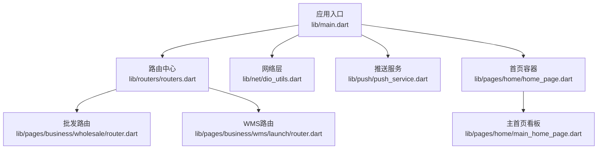
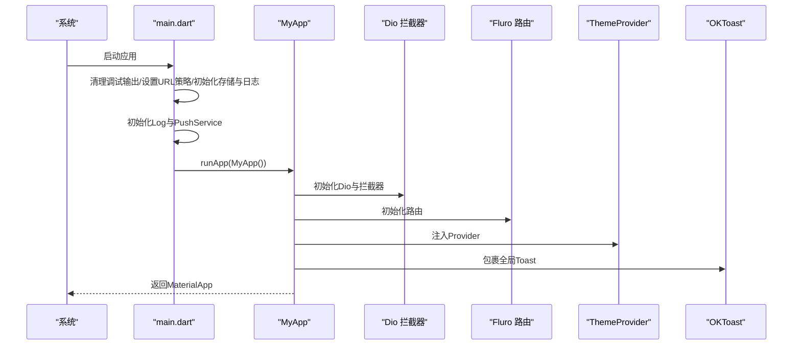
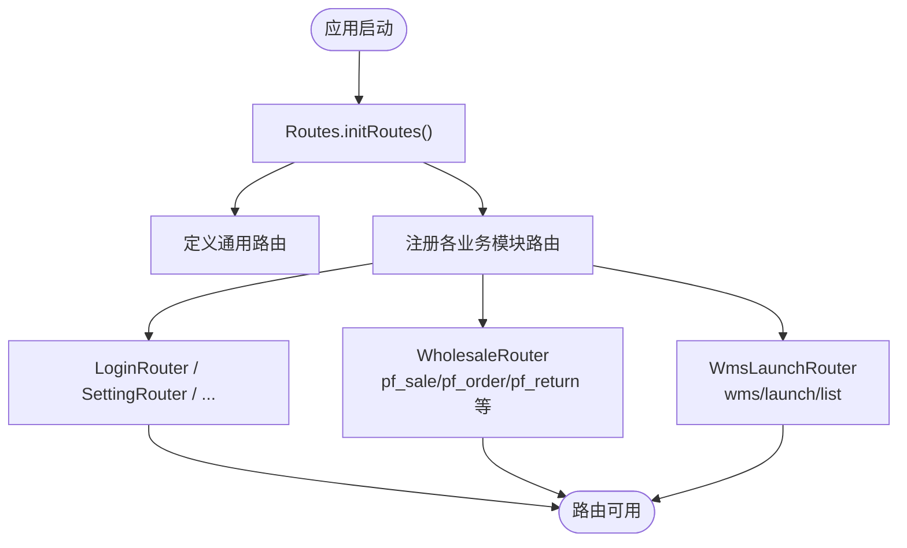
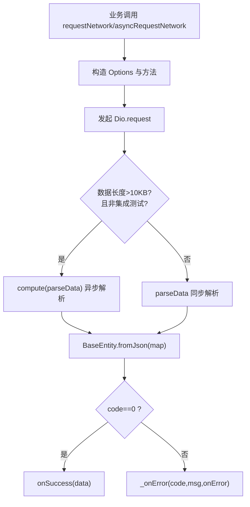
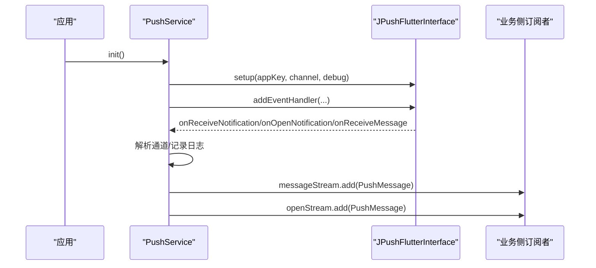
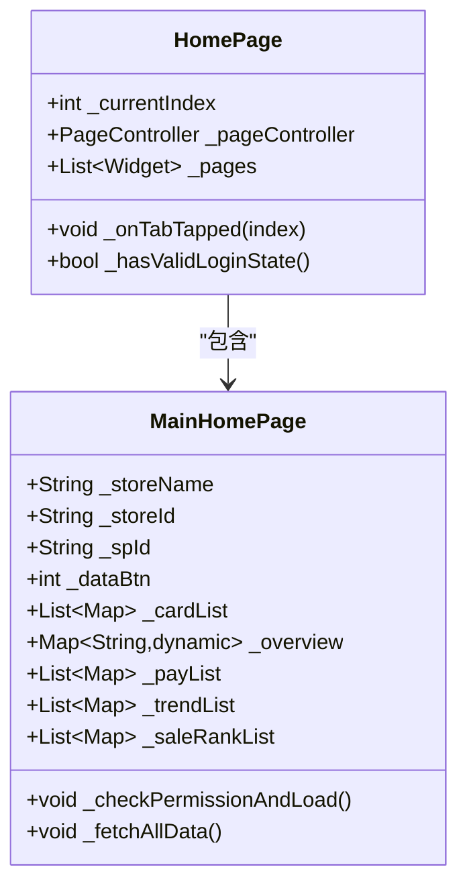
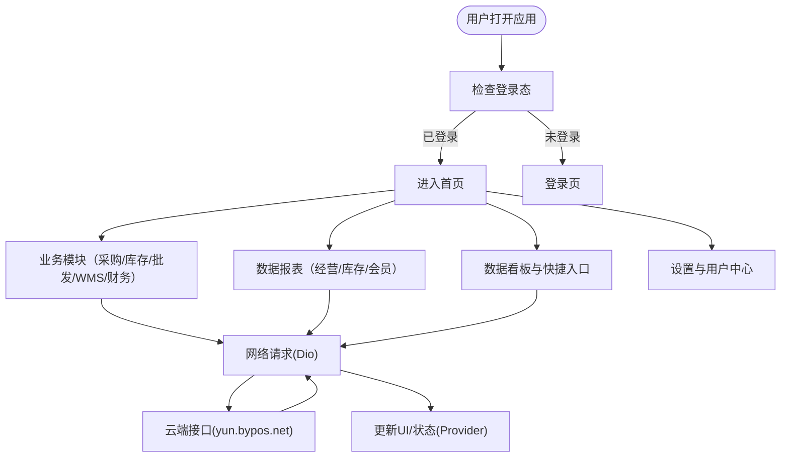
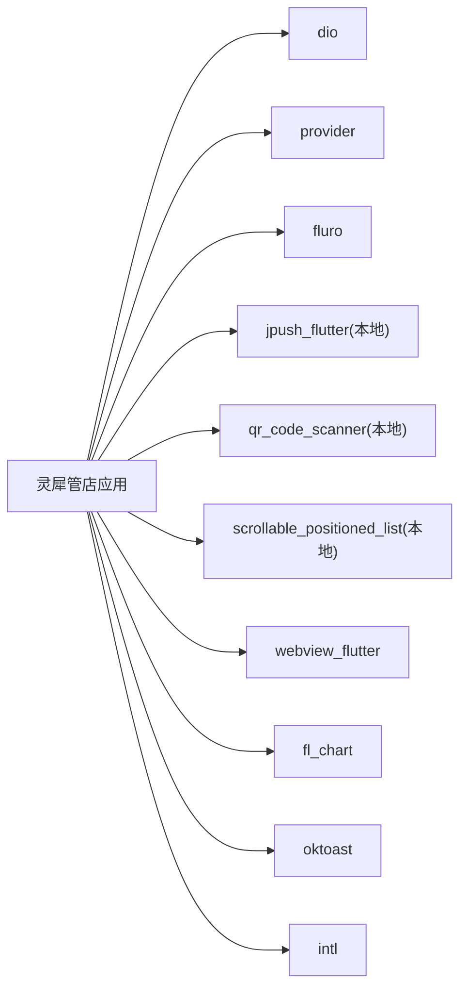

# 项目概述

<cite>
**本文引用的文件**   
- [pubspec.yaml](file://pubspec.yaml)
- [README.md](file://README.md)
- [lib/main.dart](file://lib/main.dart)
- [lib/routers/routers.dart](file://lib/routers/routers.dart)
- [lib/pages/business/wholesale/router.dart](file://lib/pages/business/wholesale/router.dart)
- [lib/pages/business/wms/launch/router.dart](file://lib/pages/business/wms/launch/router.dart)
- [lib/net/dio_utils.dart](file://lib/net/dio_utils.dart)
- [lib/pages/home/home_page.dart](file://lib/pages/home/home_page.dart)
- [lib/pages/home/main_home_page.dart](file://lib/pages/home/main_home_page.dart)
- [lib/push/push_service.dart](file://lib/push/push_service.dart)
</cite>

## 目录
1. [引言](#引言)
2. [项目结构](#项目结构)
3. [核心组件](#核心组件)
4. [架构总览](#架构总览)
5. [详细组件分析](#详细组件分析)
6. [依赖关系分析](#依赖关系分析)
7. [性能与平台特性](#性能与平台特性)
8. [故障排查指南](#故障排查指南)
9. [结论](#结论)
10. [附录：功能域与业务场景](#附录功能域与业务场景)

## 引言
灵犀管店是一个面向零售与批发业务的 Flutter 多端应用，覆盖 Android、iOS 与 Web。项目围绕门店运营工具展开，提供基础资料、进销存、财务、会员、批发、WMS、报表等能力，并通过极光推送、扫码、打印等硬件与系统能力增强线下门店体验。技术栈以 Flutter >= 3.19.0 为核心，使用 Dio 进行网络请求封装，Provider 做状态管理，Fluro 管理路由，并结合本地日志、权限控制与版本检查形成完整的应用生命周期。

项目的商业价值在于帮助中小型零售/批发企业统一门店运营入口，打通“前台销售—库存—财务—报表”的数据闭环，并通过多端适配降低开发与运维成本；应用场景包括收银台、拣货、盘点、对账、经营看板、总部数据汇总等。

**章节来源**
- [pubspec.yaml:1-153](file://pubspec.yaml#L1-L153)
- [README.md:1-210](file://README.md#L1-L210)

## 项目结构
仓库采用 Flutter 标准工程布局，并在 `lib` 下按领域与职责划分：
- `lib/main.dart`：应用入口，负责全局初始化、主题、路由、网络、推送与异常处理。
- `lib/routers`：基于 Fluro 的模块化路由注册中心与各子模块路由器。
- `lib/net`：Dio 配置、拦截器、统一响应体与错误处理。
- `lib/pages`：页面与业务模块，如首页、登录、业务（基础资料、采购、库存、批发、WMS、财务）、数据报表、设置与用户中心等。
- `lib/components`：可复用选择器与通用弹窗。
- `lib/util`：设备、权限、扫码、打印、语音识别、日志上传等工具。
- `lib/push`：极光推送服务封装。
- `packages`：内嵌第三方包或自维护插件，如 jpush_flutter、qr_code_scanner、scrollable_positioned_list。

**图表来源**
- [lib/main.dart:1-204](file://lib/main.dart#L1-L204)
- [lib/routers/routers.dart:1-176](file://lib/routers/routers.dart#L1-L176)
- [lib/net/dio_utils.dart:1-204](file://lib/net/dio_utils.dart#L1-L204)
- [lib/pages/home/home_page.dart:1-184](file://lib/pages/home/home_page.dart#L1-L184)
- [lib/pages/home/main_home_page.dart:1-260](file://lib/pages/home/main_home_page.dart#L1-L260)
- [lib/pages/business/wholesale/router.dart:1-54](file://lib/pages/business/wholesale/router.dart#L1-L54)
- [lib/pages/business/wms/launch/router.dart:1-17](file://lib/pages/business/wms/launch/router.dart#L1-L17)

**章节来源**
- [pubspec.yaml:1-153](file://pubspec.yaml#L1-L153)
- [lib/main.dart:1-204](file://lib/main.dart#L1-L204)
- [lib/routers/routers.dart:1-176](file://lib/routers/routers.dart#L1-L176)

## 核心组件
- 应用入口与初始化
  - 清理生产环境 debug 输出、设置 URL 策略、初始化本地存储、日志系统、极光推送、系统 UI 样式，并启动 MyApp。
  - 在 MyApp 中统一初始化 Dio、Fluro 路由、Provider 主题 Provider、Toast、国际化与未匹配路由兜底。
- 路由系统
  - 通过 Routes 集中注册各业务模块的路由，每个模块实现 IRouterProvider 并提供 initRouter(router) 完成自身路由定义。
- 网络层
  - 封装 DioUtils，统一超时、BaseOptions、拦截器链、JSON 解析、成功/失败回调、取消请求日志与异常映射。
- 推送服务
  - 封装 JPushFlutterInterface，提供初始化、事件订阅、长连接状态、消息流、通知点击分发与通道信息记录。
- 首页与业务容器
  - HomePage 作为底部 Tab 容器，承载首页、业务、报表、我的四大模块；MainHomePage 对齐 Boss 项目数据看板，聚合卡片、概览、付款方式、趋势与销售排行。

**章节来源**
- [lib/main.dart:1-204](file://lib/main.dart#L1-L204)
- [lib/routers/routers.dart:1-176](file://lib/routers/routers.dart#L1-L176)
- [lib/net/dio_utils.dart:1-204](file://lib/net/dio_utils.dart#L1-L204)
- [lib/push/push_service.dart:1-220](file://lib/push/push_service.dart#L1-L220)
- [lib/pages/home/home_page.dart:1-184](file://lib/pages/home/home_page.dart#L1-L184)
- [lib/pages/home/main_home_page.dart:1-260](file://lib/pages/home/main_home_page.dart#L1-L260)

## 架构总览
灵犀管店采用“入口 + 分层 + 模块化”的总体架构：
- 入口层：main.dart 完成基础设施初始化与根 Widget 构建。
- 表现层：pages 下的业务页面，通过 Router 跳转与 Provider 共享状态。
- 业务层：business、data、user、setting 等业务域，各自维护路由与页面。
- 支撑层：net 网络层、util 工具集、components 通用组件、push 推送、routers 路由中心。

```mermaid
graph TB
  subgraph "入口层"
    M["main.dart<br/>应用初始化"]
  end

  subgraph "表现层"
    HP["home_page.dart<br/>Tab 容器"]
    MH["main_home_page.dart<br/>数据看板"]
    BP["business/*<br/>业务页面"]
    DP["data/*<br/>数据报表"]
    UP["user/*<br/>用户与设置"]
  end

  subgraph "支撑层"
    R["routers/routers.dart<br/>Fluro 路由中心"]
    N["net/dio_utils.dart<br/>Dio 封装"]
    P["push/push_service.dart<br/>JPush 推送"]
    U["util/*<br/>工具集"]
  end

  M --> R
  M --> N
  M --> P
  M --> HP
  HP --> MH
  HP --> BP
  HP --> DP
  HP --> UP
  BP --> N
  DP --> N
  MH --> N
  P --> N
```

**图表来源**
- [lib/main.dart:1-204](file://lib/main.dart#L1-L204)
- [lib/routers/routers.dart:1-176](file://lib/routers/routers.dart#L1-L176)
- [lib/net/dio_utils.dart:1-204](file://lib/net/dio_utils.dart#L1-L204)
- [lib/pages/home/home_page.dart:1-184](file://lib/pages/home/home_page.dart#L1-L184)
- [lib/pages/home/main_home_page.dart:1-260](file://lib/pages/home/main_home_page.dart#L1-L260)
- [lib/push/push_service.dart:1-220](file://lib/push/push_service.dart#L1-L220)

## 详细组件分析

### 应用入口与全局初始化流程
入口 main.dart 在执行 runApp 前完成：
- 生产模式关闭 debugPrint
- 设置 URL 策略（Web 去除 #）
- 初始化本地存储与文件日志
- 初始化 Log 与 PushService
- 配置系统 UI 样式
- 构建 MyApp，注入 Provider、OKToast、MaterialApp 与路由

MyApp 内部进一步：
- 初始化 Dio 拦截器链（鉴权、Token 刷新、日志、适配器）
- 初始化 Fluro 路由
- 通过 MultiProvider 注入 ThemeProvider
- MaterialApp 配置主题、本地化、navigatorKey、观察者与未知路由

**图表来源**
- [lib/main.dart:1-204](file://lib/main.dart#L1-L204)

**章节来源**
- [lib/main.dart:1-204](file://lib/main.dart#L1-L204)

### 路由架构与模块化注册
Routes 类维护全局路由常量与 FluroRouter 实例，initRoutes 中：
- 设置未找到路由处理器
- 定义通用路由（首页、WebView、卡券设置、库存预警、拣货等）
- 清空并填充 _listRouter，统一调用 LoginRouter、PurchaseRouter、WholesaleRouter、WmsLaunchRouter、InventoryRouter、FinanceRouter、BusinessAnalysisRouter 等模块路由
- 最终遍历调用各模块的 initRouter(router)

各业务模块通过实现 IRouterProvider 暴露自己的路由定义，例如 WholesaleRouter 与 WmsLaunchRouter。

**图表来源**
- [lib/routers/routers.dart:1-176](file://lib/routers/routers.dart#L1-L176)
- [lib/pages/business/wholesale/router.dart:1-54](file://lib/pages/business/wholesale/router.dart#L1-L54)
- [lib/pages/business/wms/launch/router.dart:1-17](file://lib/pages/business/wms/launch/router.dart#L1-L17)

**章节来源**
- [lib/routers/routers.dart:1-176](file://lib/routers/routers.dart#L1-L176)
- [lib/pages/business/wholesale/router.dart:1-54](file://lib/pages/business/wholesale/router.dart#L1-L54)
- [lib/pages/business/wms/launch/router.dart:1-17](file://lib/pages/business/wms/launch/router.dart#L1-L17)

### 网络层设计与数据处理
DioUtils 是网络层的统一入口，关键设计点：
- BaseOptions：统一超时、baseUrl、responseType 为 plain，validateStatus 返回 true，交由 AdapterInterceptor 判断业务状态码。
- 拦截器链：AuthInterceptor、TokenInterceptor、LoggingInterceptor（非生产禁用）、AdapterInterceptor。
- 统一响应：将 JSON 解析为 BaseEntity<T>，code==0 视为成功。
- 并发与性能：对大于 10KB 的非集成测试响应使用 compute 异步解析，减少主线程阻塞。
- 回调模型：requestNetwork 与 asyncRequestNetwork 分别提供 Future 与 Stream 风格接口，统一 onError 回调与取消请求日志。

**图表来源**
- [lib/net/dio_utils.dart:1-204](file://lib/net/dio_utils.dart#L1-L204)

**章节来源**
- [lib/net/dio_utils.dart:1-204](file://lib/net/dio_utils.dart#L1-L204)

### 推送服务与事件分发
PushService 封装 JPushFlutterInterface，主要职责：
- init：根据平台是否支持（Android/iOS），注册事件处理器、setup SDK、获取 RegistrationID、延迟 bindUser。
- 事件监听：onReceiveNotification、onOpenNotification、onReceiveMessage、onNotifyMessageUnShow、onConnected、onCommandResult。
- 通道解析：从 extras 中解析 cn.jpush.android.TYPE_PLATFORM，结合 iOS 固定为 APNs，输出可读通道名用于日志与审计。
- 消息分发：通过 messageStream 与 openStream 暴露广播流，供业务侧订阅自定义消息与通知点击行为。

**图表来源**
- [lib/push/push_service.dart:1-220](file://lib/push/push_service.dart#L1-L220)

**章节来源**
- [lib/push/push_service.dart:1-220](file://lib/push/push_service.dart#L1-L220)

### 首页与数据看板
HomePage 作为底部导航容器，包含四个 Tab：首页、业务、报表、我的。其职责包括：
- 防御性登录校验：若缓存缺失 token 或商户信息，立即跳转到 LoginPage。
- 初始化设备信息、版本检查、权限数据预取与登录参数刷新。
- 切换 Tab 时触发权限刷新，避免角色缓存过期导致权限不一致。

MainHomePage 对齐 Boss 项目数据看板，聚合：
- 首页卡片顺序与可见性配置
- 营业/储值数据、预警信息、付款方式、营业额/客流量趋势、分类/单品销售榜
- 机构选择与总部/门店视图差异
- 时间维度（昨天/今日/本周/本月/上月）与零售/批发切换
- 审批提醒与库存不足提醒

**图表来源**
- [lib/pages/home/home_page.dart:1-184](file://lib/pages/home/home_page.dart#L1-L184)
- [lib/pages/home/main_home_page.dart:1-260](file://lib/pages/home/main_home_page.dart#L1-L260)

**章节来源**
- [lib/pages/home/home_page.dart:1-184](file://lib/pages/home/home_page.dart#L1-L184)
- [lib/pages/home/main_home_page.dart:1-260](file://lib/pages/home/main_home_page.dart#L1-L260)

### 概念性总览
下图给出一个不绑定具体源码的概念流程图，帮助初学者理解整体工作流：

[本图为概念图，无需代码来源]

## 依赖关系分析
- 框架与语言
  - Flutter >= 3.19.0，Dart SDK >= 3.4.0 < 4.0.0
- 核心三方库
  - dio：网络请求与拦截器
  - provider：状态管理
  - fluro：模块化路由
  - jpush_flutter：极光推送（本地维护）
  - qr_code_scanner：二维码扫描（本地维护）
  - scrollable_positioned_list：滚动定位列表（本地维护）
  - webview_flutter、image_picker、device_info_plus、permission_handler、fl_chart、oktoast、intl、url_launcher、flutter_svg、barcode_widget、qr_flutter、archive、data_table_2 等
- 本地包与补丁
  - packages/jpush_flutter：对 extras 透出下发通道 TYPE_PLATFORM 打补丁
  - packages/qr_code_scanner：二维码扫描插件
  - packages/scrollable_positioned_list：替代 azlistview 升级依赖

**图表来源**
- [pubspec.yaml:1-153](file://pubspec.yaml#L1-L153)

**章节来源**
- [pubspec.yaml:1-153](file://pubspec.yaml#L1-L153)

## 性能与平台特性
- 大体积响应异步解析：当返回数据超过 10KB 且非集成测试时，使用 compute 异步解析 JSON，降低主线程卡顿风险。
- Web 平台优化：使用 url_strategy 设置 pathUrlStrategy，去除 URL 中的 #；WebView 与地图等能力在 Web 上具备相应实现。
- 推送平台差异：PushService 在 Web 平台直接跳过初始化，不影响页面显示；Android/iOS 走厂商通道与极光长连接。
- 深色模式与国际化：MaterialApp 配置 darkTheme 与 zh-CN 本地化。
- 系统 UI：统一设置状态栏图标与文字亮度，保证浅色背景可读性。

**章节来源**
- [lib/net/dio_utils.dart:1-204](file://lib/net/dio_utils.dart#L1-L204)
- [lib/push/push_service.dart:1-220](file://lib/push/push_service.dart#L1-L220)
- [lib/main.dart:1-204](file://lib/main.dart#L1-L204)
- [pubspec.yaml:1-153](file://pubspec.yaml#L1-L153)

## 故障排查指南
- 登录态异常
  - 现象：进入首页后立即跳回登录页。
  - 排查：检查本地 token 与 store 字段是否有效，HomePage 与 MyApp 均做了防御性校验。
  - 相关路径：HomePage._hasValidLoginState、MyApp._checkLoginState。
- 网络请求失败
  - 现象：onError 回调返回 code/msg，或控制台出现“接口请求异常”。
  - 排查：确认 baseUrl、拦截器链是否正常；查看 AdapterInterceptor 的业务码逻辑；关注 compute 解析异常分支。
  - 相关路径：DioUtils.requestNetwork/_request/_onError。
- 推送无通知或未展示
  - 现象：通知未出现在通知栏或点击无效。
  - 排查：确认 Android/iOS 平台；检查推送初始化是否成功；查看通道解析与日志（极光/厂商通道/APNs）。
  - 相关路径：PushService.init/_registerEventHandler/_handlePushEvent/_resolveChannel。
- 路由未命中
  - 现象：跳转后显示 NotFoundPage 或控制台打印“未找到目标页”。
  - 排查：确认路由常量与模块 initRouter 是否正确注册。
  - 相关路径：Routes.initRoutes/notFoundHandler。

**章节来源**
- [lib/pages/home/home_page.dart:1-184](file://lib/pages/home/home_page.dart#L1-L184)
- [lib/main.dart:1-204](file://lib/main.dart#L1-L204)
- [lib/net/dio_utils.dart:1-204](file://lib/net/dio_utils.dart#L1-L204)
- [lib/push/push_service.dart:1-220](file://lib/push/push_service.dart#L1-L220)
- [lib/routers/routers.dart:1-176](file://lib/routers/routers.dart#L1-L176)

## 结论
灵犀管店以 Flutter 为核心，结合 Dio、Provider、Fluro、JPush 等成熟生态组件，构建了覆盖零售与批发的全链路门店运营应用。通过模块化路由、统一网络层、推送服务与完善的工具集，项目在功能完整性、多端适配与可维护性方面具备良好的工程实践。对于初学者，可从入口初始化、路由注册、网络封装与首页看板逐步理解项目；对于有经验的开发者，可重点关注网络层抽象、推送通道解析、权限控制与多端差异化处理。

[本节为总结性内容，不直接分析具体文件]

## 附录：功能域与业务场景
- 零售与批发业务管理
  - 基础资料：商品、分类、包装价、打印模板、调价计划等。
  - 采购：订单、其他入库、退货申请/发货、供应商管理等。
  - 库存：入库出库、移仓、盘点、计划、查询等。
  - 批发：客户管理、批发订单、批发销售、批发退货、订单汇总、收款汇总、选客员等。
  - WMS：发货、收货、补货、库存查询、WMS 设置等。
  - 财务：成本收入、客户应收、门店应付、供应商应付等。
- 门店运营工具
  - 扫码（QR Code）、蓝牙打印机、标签打印、业务打印、语音识别、权限与席位管理。
- 数据报表
  - 经营分析、现金流、现金统计、收银监控、异常监控、ABC 分析、销售占比、会员消费 TOP、优惠券分析等。
- 多端适配
  - Android、iOS、Web；Web 使用 pathUrlStrategy，地图、WebView、扫码等在 Web 上有对应实现。
- 硬件集成
  - 扫码、打印、振动、权限、设备信息等。

[本节为概念性内容，不直接分析具体文件]